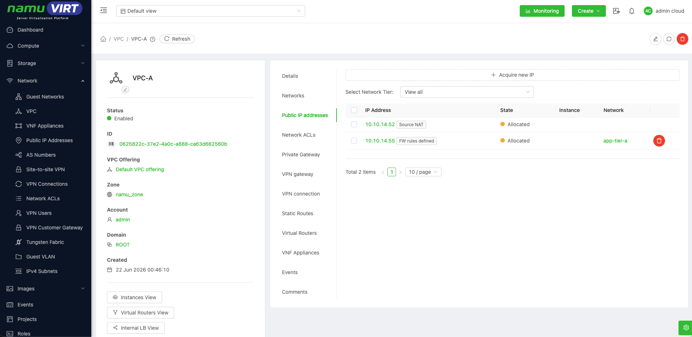
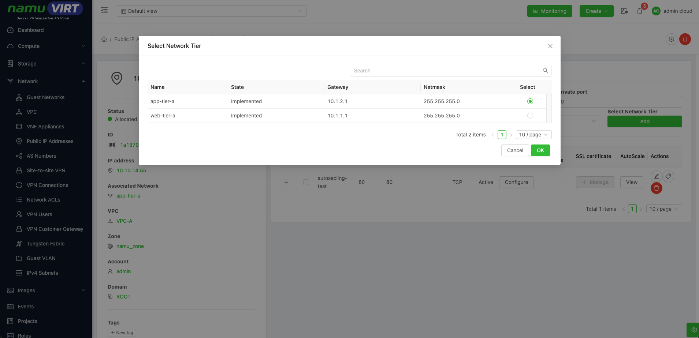
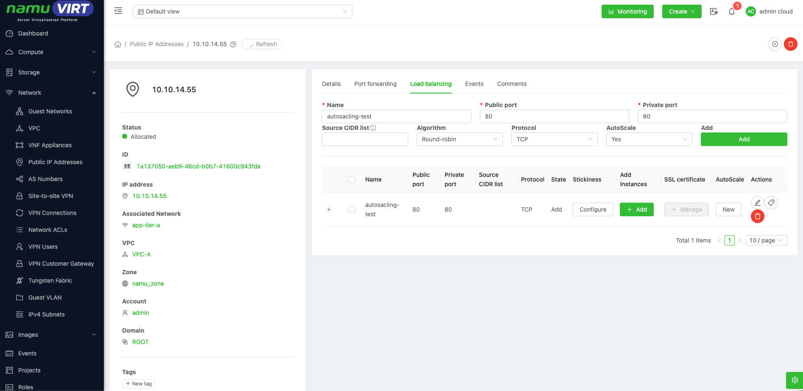
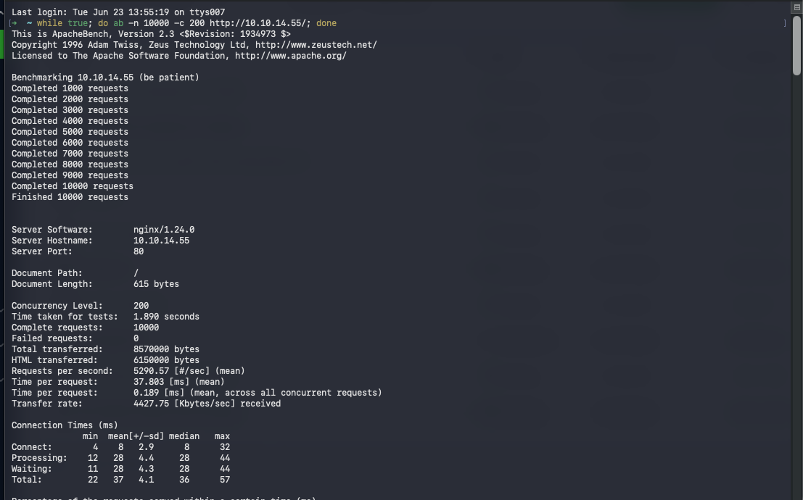
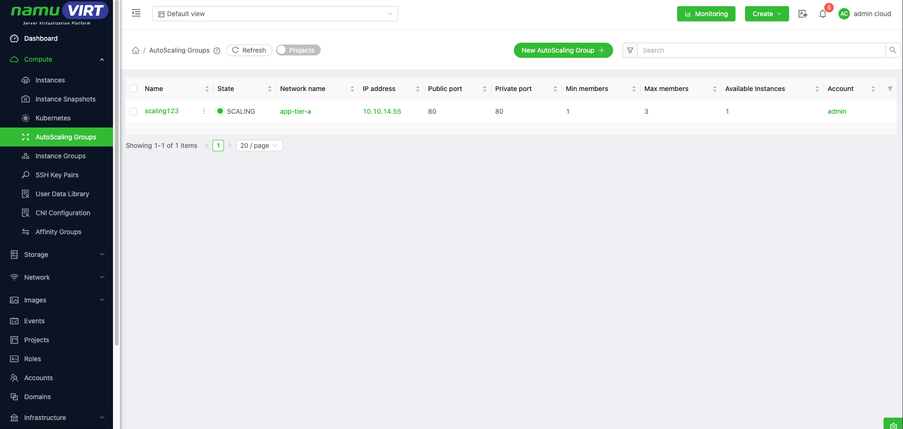
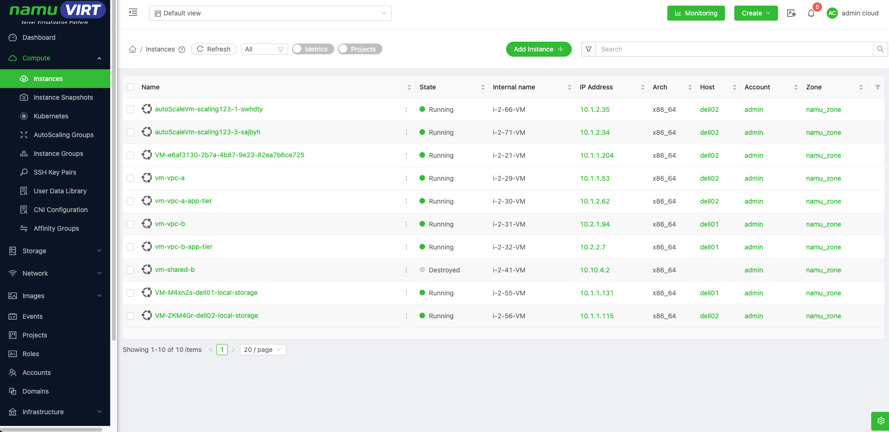

namuVIRT에서 AutoScaling Group은 로드밸런서와 연결된 VM 그룹의 인스턴스 수를 모니터링 지표와 정책에 따라 자동으로 Scale-in/Scale-out 하기위한 기능이다.

## Compute Offering 생성 {#compute-offering-생성 .j-제목-3}

AutoScaling Group에서 사용할 Compute Offering 규격을 정의한다. AutoScaling Group의 최대 VM 수 만큼 자원이 증가할 수 있으므로 Cluster와 Host에 충분한 Capacity가 있어야 하고 이를 고려하여 Compute Offering을 정의해야 한다.

- **추가방법** : **사용자 메뉴얼 \> Service Offering \> Compute Offering** 생성 방법 참고

Compute Offering을 추가할 때 필수로 Dynamic Scaling Enabled 옵션을 활성화해야 한다.

## Public IP 생성 및 Load Balancer 생성 {#public-ip-생성-및-load-balancer-생성 .j-제목-3}

AutoScaling Group을 활용하기 위해서는 Load Balancer가 필요하다. 이때 사용할 Public IP를 생성하고 Load Balancer Rule을 생성해야 한다. Public IP 는 Guest Network 또는 VPC 의 상세 페이지에서 생성 가능하다.

{width="6.578133202099737in" height="3.2222222222222223in"}

> 그림 ‑ Public IP 생성

생성된 Public IP의 상세 페이지로 이동하여 Load Balancing 탭에서 정책을 추가할 수 있다. 이때 AutoScale 옵션을 "Yes"로 지정하고 Add버튼을 클릭하여 Public IP가 위치한 네트워크를 선택한다.

{width="6.578133202099737in" height="3.1805555555555554in"}

> 그림 ‑ Public IP가 할당된 네트워크 추가

{width="6.578133202099737in" height="3.2083333333333335in"}

> 그림 ‑ Load Balancing 추가 완료

## AutoScaling Groups 생성 {#autoscaling-groups-생성 .j-제목-3}

사전 작업이 완료되면 AutoScaling Group을 추가할 수 있다

- **추가방법 : 사용자 메뉴얼 \> Compute \> AutoScaling Group** 추가 확인

## AutoScaling Groups 테스트 {#autoscaling-groups-테스트 .j-제목-3}

Apache Bench를 통해 Load Balancer에 부하를 주고 AutoScaling이 동작하는 것을 확인할 수 있다.

{width="6.578133202099737in" height="4.097222222222222in"}

> 그림 ‑ Apache Bench 를 이용한 Load Balancer 부하

AutoScaling Groups 에서 Group의 상태가 "ENABLED"에서 "SCALING"으로 변경된 것을 확인할 수 있다.

{width="6.5625in" height="2.9375in"}

> 그림 ‑ Auto Scaling Group의 상태 "SCALING" 변경

Instances 메뉴에서 기본으로 생성된 VM 이외에 추가 VM이 생성된 것을 확인할 수 있다.

{width="6.578133202099737in" height="3.1944444444444446in"}

> 그림 ‑ Auto Scaling Group에 의한 Instance 추가
