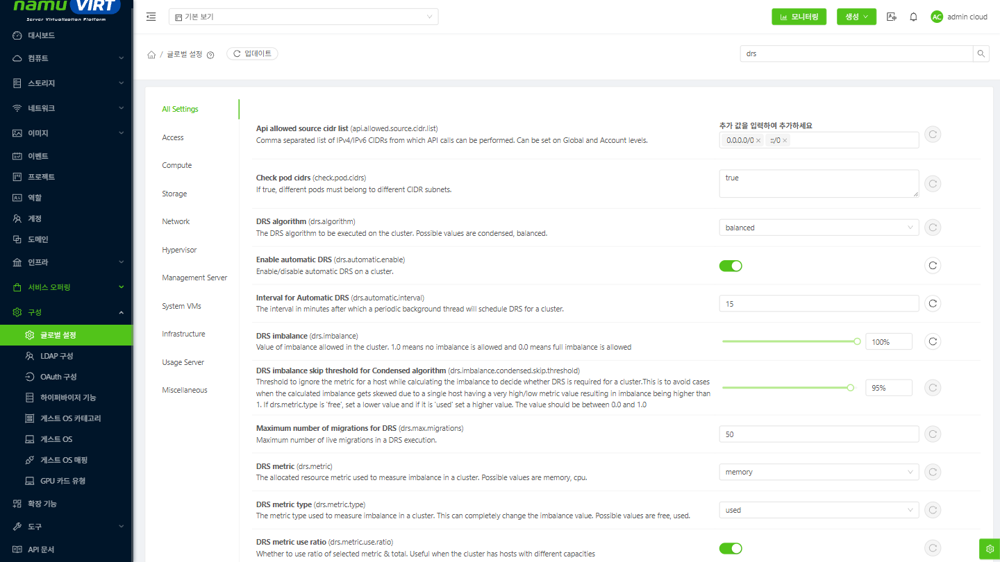
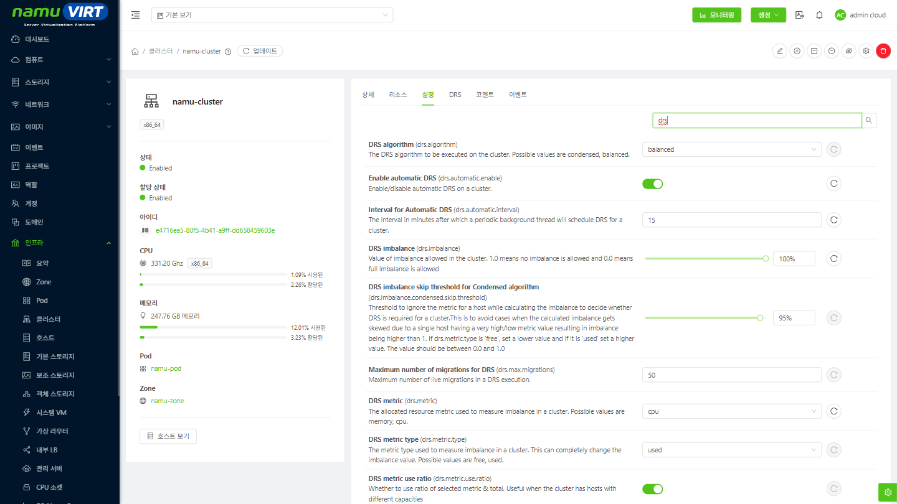
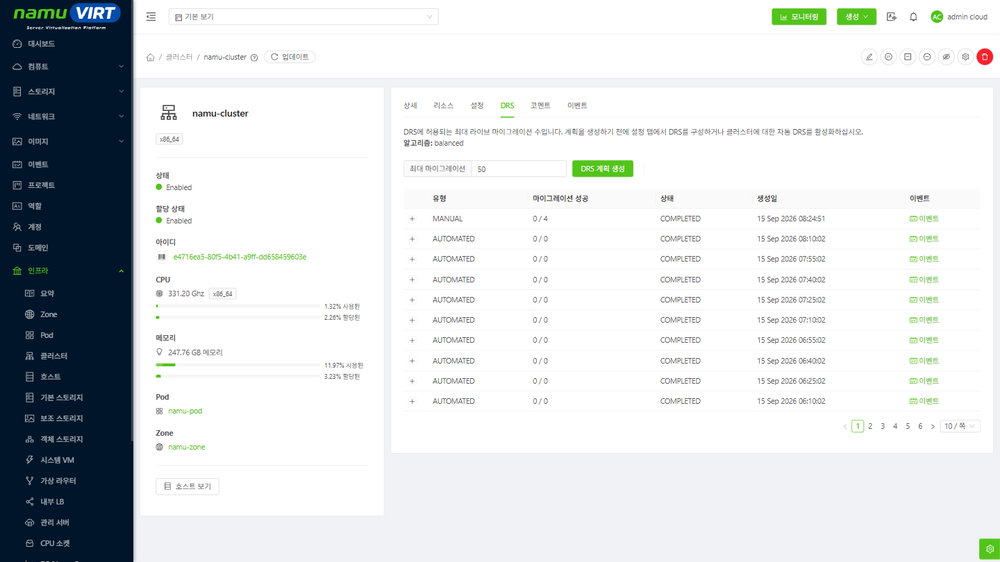
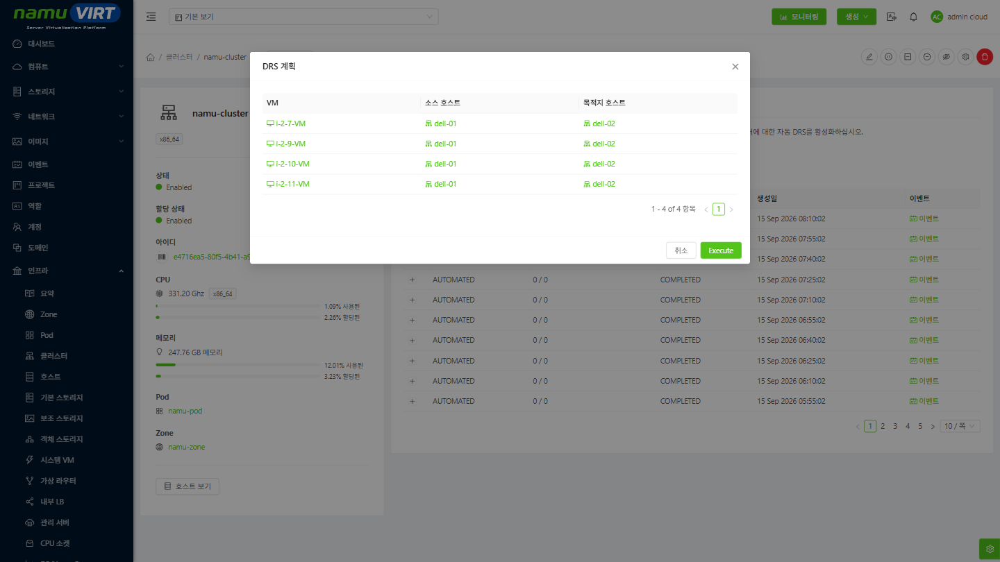
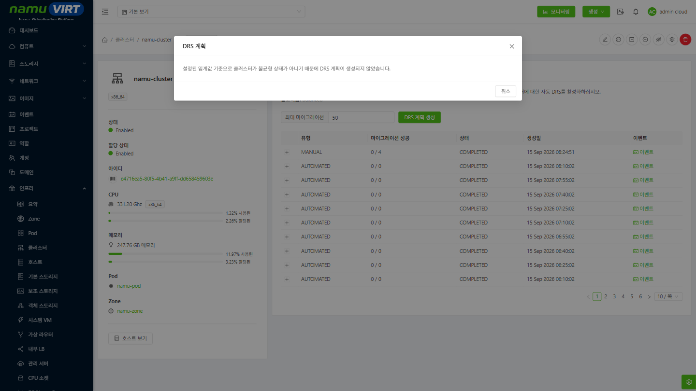
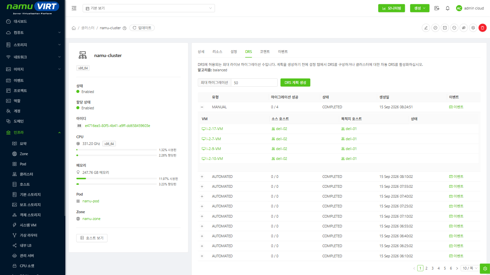
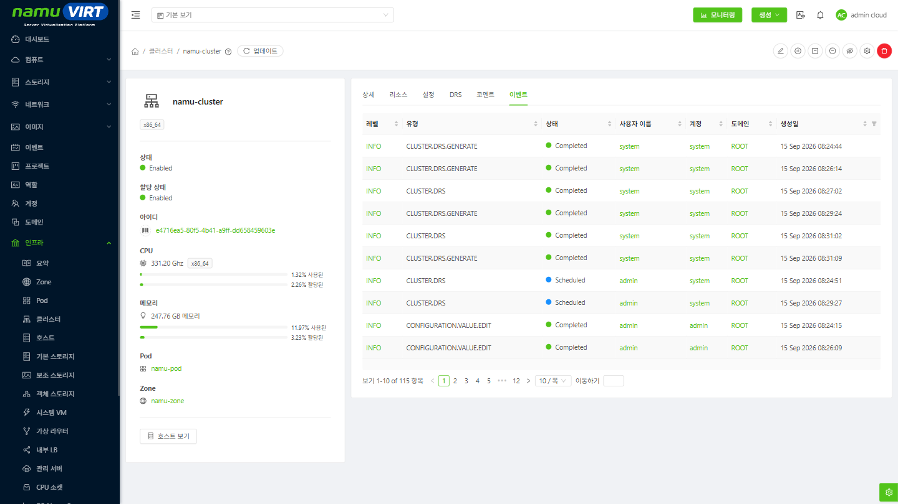
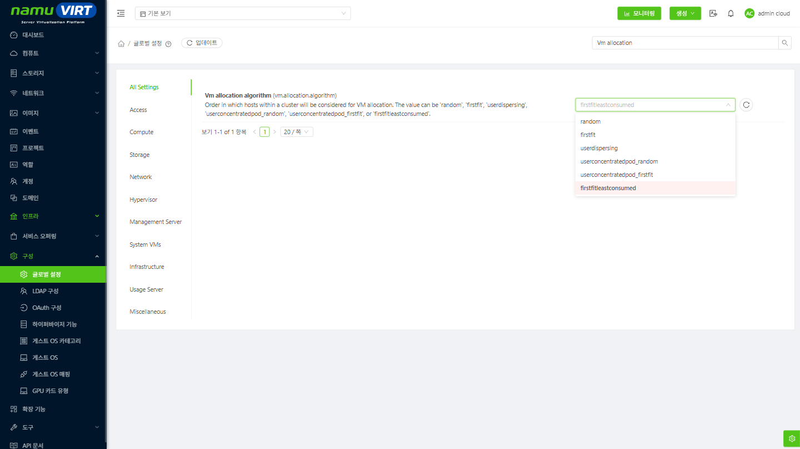

DRS(Distributed Resource Scheduler)는 클러스터 내 호스트 간 자원 불균형을 감지하고, 인스턴스를 Live Migration하여 전체 자원 배치를 최적화하는 기능입니다. 인스턴스의 생성 및 규모 변경 등으로 발생하는 부하 집중을 정해진 알고리즘과 임계값에 따라 자동 해소하여 관리자의 수동 개입 부담을 줄여줍니다.

단, DRS는 기존 Live Migration 기능을 활용해 단일 클러스터 내에서만 동작하며, 다른 클러스터 간의 인스턴스 재배치는 수행하지 않습니다.

참고: DRS 기능은 기본적으로 비활성화되어 있으며, 작동 및 검증을 위해서는 동일한 클러스터 내에 2개 이상의 호스트가 필요합니다.

## 사전 조건 {#사전-조건 .j-제목-3}

DRS를 적용하기 전에 다음 조건을 확인한다.

- 동일한 Cluster 내에 **두 개 이상의 Host**가 Up 상태로 존재해야 한다.

- 대상 Instance가 **Live Migration이 가능한 상태**여야 한다. 일반적으로 iSCSI 또는 NFS와 같은 Shared Storage 환경이 필요하며, Local Storage를 사용하는 Instance는 재배치 대상에서 제외될 수 있다.

- 이동 대상 Host가 Instance의 CPU/Memory 요구량을 수용할 수 있는 가용 용량을 가지고 있어야 한다.

- Affinity Group, Host Tag 등 배치 제약이 설정된 Instance는 해당 제약을 만족하는 Host로만 이동한다.

DRS는 현재 Instance 배치 상태와 Affinity Group을 기준으로 계획을 생성하며, Instance 최초 배치에 사용되는 Allocation Algorithm 또는 Deployment Planner 설정과는 별개로 동작한다. 최초 배치 정책은 아래 **Allocation Algorithm** 항목을 참고한다.

## DRS 알고리즘 {#drs-알고리즘 .j-제목-3}

namuVIRT는 두 가지 DRS 알고리즘을 제공하며, Cluster 단위로 선택할 수 있다.

  -------------------------------------------------------------------------------------------------------------------------------------------------------------------------------------------------------------------------------
     **알고리즘**     **동작**                                      **용도**
  ------------------- --------------------------------------------- -------------------------------------------------------------------------------------------------------------------------------------------------------------
   balanced (기본값)  Instance를 여러 Host에 고르게 분산한다.       특정 Host 장애 시 영향 범위를 줄이고 자원 경합을 완화해야 하는 운영 환경에 적합하다. 모든 Host가 가동 상태를 유지하므로 전력 소모는 상대적으로 크다.

       condensed      Instance를 최소한의 Host에 모아서 배치한다.   유휴 Host를 만들어 전력과 냉각 비용을 줄이는 것이 목적이다. 하나의 Host에 Instance가 집중되어 자원 경합이 발생할 수 있으므로 운영 환경에는 권장하지 않는다.
  -------------------------------------------------------------------------------------------------------------------------------------------------------------------------------------------------------------------------------

  : 표 ‑ DRS 알고리즘 별 동작 및 용도

## 불균형(Imbalance) 판단 기준 {#불균형imbalance-판단-기준 .j-제목-3}

DRS는 Cluster 내 Host들의 Metric 값에 대한 **표준편차를 평균으로 나눈 값**을 불균형(Imbalance) 지표로 사용한다. 값이 0에 가까울수록 Host 간 자원 사용이 균등한 상태이다.

이 값과 **drs.imbalance** 설정값을 비교하여 DRS 수행 여부를 판단하며, 알고리즘에 따라 비교 기준이 다르다.

- **balanced** : 임계값은 1.0 - drs.imbalance이며, 계산된 불균형 값이 이 임계값보다 **크면** DRS를 수행한다. 기본값 0.4인 경우 임계값은 0.6이 된다.

- **condensed** : 임계값은 drs.imbalance 값 자체이며, 계산된 불균형 값이 이 임계값보다 **작으면** DRS를 수행한다.

따라서 두 알고리즘 모두 **drs.imbalance 값이 클수록 DRS가 더 적극적으로 동작**한다. 1.0은 불균형을 허용하지 않는다는 의미이고, 0.0은 불균형을 모두 허용한다는 의미이다.

불균형 계산에 사용할 지표는 **drs.metric**(cpu 또는 memory)과 **drs.metric.type**(used 또는 free)으로 지정하며, Host별 용량이 서로 다른 Cluster에서는 **drs.metric.use.ratio**를 활성화하여 절대값이 아닌 비율로 계산하도록 한다.

## DRS 설정 {#drs-설정 .j-제목-3}

DRS 관련 설정은 전역(Global) 또는 Cluster 단위로 지정할 수 있다. 대부분의 설정이 Cluster Scope를 지원하므로, 운영 환경에서는 Cluster별로 값을 조정하는 것을 권장한다.

## 전역 설정 확인 {#전역-설정-확인 .j-제목-3}

- **구성(Configuration) \> 글로벌 설정(Global Settings)**에서 **drs**로 검색하여 전체 DRS 설정값을 확인한다.

{width="6.58in" height="3.70125in"}

> 그림 ‑ 글로벌 설정에서 DRS 설정 조회

## Cluster 단위 설정 {#cluster-단위-설정 .j-제목-3}

- **인프라(Infrastructure) \> 클러스터(Clusters) \> 클러스터 상세 \> 설정(Settings)** 탭에서 해당 Cluster에만 적용되는 DRS 설정값을 지정한다.

{width="6.58in" height="3.70125in"}

> 그림 ‑ 클러스터 설정 탭에서 DRS 설정 변경

## 설정 항목 {#설정-항목 .j-제목-3}

  ----------------------------------------------------------------------------------------------------------------------------------------------------------------------------------------------------------------------------------
                 **설정명**                **기본값**   **설명**
  ---------------------------------------- ------------ ----------------------------------------------------------------------------------------------------------------------------------------------------------------------------
            drs.automatic.enable           false        Cluster에 대한 자동 DRS 사용 여부를 지정한다.

           drs.automatic.interval          60           자동 DRS를 수행하는 주기(분)를 지정한다.

               drs.algorithm               balanced     Cluster에 적용할 DRS 알고리즘을 지정한다. (condensed, balanced)

               drs.imbalance               0.4          Cluster에서 허용할 불균형 수준을 지정한다. 1.0은 불균형을 허용하지 않고 0.0은 불균형을 모두 허용한다.

                 drs.metric                memory       불균형 판단에 사용할 자원 지표를 지정한다. (memory, cpu)

              drs.metric.type              used         불균형 판단에 사용할 지표 유형을 지정한다. 값에 따라 불균형 계산 결과가 크게 달라질 수 있다. (free, used)

            drs.metric.use.ratio           true         선택한 지표를 전체 용량 대비 비율로 계산할지 여부를 지정한다. Host 용량이 서로 다른 Cluster에서 유용하다.

   drs.imbalance.condensed.skip.threshold  0.95         condensed 알고리즘에서 불균형 계산 시 특정 Host의 지표를 제외할 임계값을 지정한다. drs.metric.type이 \'free\'이면 낮은 값을, \'used\'이면 높은 값을 설정한다. (0.0 \~ 1.0)

             drs.max.migrations            50           DRS 1회 실행에서 허용되는 최대 Live Migration 수를 지정한다.

          drs.plan.expire.interval         30           오래된 DRS Plan 및 Event를 정리하는 주기(일)를 지정한다. 전역 설정으로만 지정할 수 있다.
  ----------------------------------------------------------------------------------------------------------------------------------------------------------------------------------------------------------------------------------

  : 표 ‑ DRS 설정 항목

## 수동 DRS 실행 {#수동-drs-실행 .j-제목-3}

자동 DRS를 활성화하기 전에 현재 Cluster 상태에서 어떤 재배치가 발생하는지 확인하려면 DRS 계획을 수동으로 생성하여 검토할 수 있다.

## DRS 계획 생성 {#drs-계획-생성 .j-제목-3}

1.  **인프라(Infrastructure) \> 클러스터(Clusters)**에서 대상 Cluster를 선택하고 **DRS** 탭으로 이동한다.

2.  현재 적용된 **알고리즘(Algorithm)** 값을 확인한다. 이 값은 해당 Cluster의 drs.algorithm 설정을 표시한다.

3.  **최대 마이그레이션(Max. migrations)**에 이번 계획에서 허용할 최대 Live Migration 수를 입력한다. 기본값은 해당 Cluster의 drs.max.migrations 설정값이다.

4.  **DRS 계획 생성(Generate DRS plan)** 버튼을 클릭한다.

{width="6.58in" height="3.70125in"}

> 그림 ‑ 클러스터 DRS 탭 화면

## 생성된 계획 확인 및 실행 {#생성된-계획-확인-및-실행 .j-제목-3}

계획이 생성되면 팝업 화면에 재배치 대상 목록이 표시된다. 각 항목은 **VM**, **소스 호스트(Source host)**, **목적지 호스트(Destination host)**로 구성되며, 어떤 Instance가 어느 Host로 이동하는지 확인할 수 있다.

내용을 검토한 후 **Execute** 버튼을 클릭하면 실제 Live Migration이 수행된다. 실행하지 않고 **취소(Cancel)**를 선택하면 계획만 확인하고 종료할 수 있다.

{width="6.58in" height="3.70125in"}

> 그림 ‑ 생성된 DRS 계획 확인

현재 Cluster가 설정된 임계값 기준으로 불균형 상태가 아닌 경우에는 계획이 생성되지 않으며, 다음과 같은 안내 문구가 표시된다.

{width="6.58in" height="3.70125in"}

> 그림 ‑ 불균형 상태가 아니어서 DRS 계획이 생성되지 않은 경우

\* 참고 : 운영 Instance가 포함된 환경에서는 계획을 실행하기 전에 대상 Host의 가용 용량과 Storage, Network 연결 조건을 함께 검토해야 한다.

## 자동 DRS 활성화 {#자동-drs-활성화 .j-제목-3}

수동 실행 결과를 통해 알고리즘과 임계값이 의도한 대로 동작하는 것을 확인한 후 자동 DRS를 활성화한다.

- **인프라(Infrastructure) \> 클러스터(Clusters) \> 클러스터 상세 \> 설정(Settings)** 탭에서 **drs.automatic.enable** 값을 **true**로 변경한다.

- **drs.automatic.interval**에 자동 DRS 수행 주기(분)를 지정한다.

{width="6.58in" height="3.70125in"}

> 그림 ‑ 자동 DRS 활성화

설정이 적용되면 지정한 주기마다 백그라운드 작업이 해당 Cluster의 불균형 상태를 확인하고, 임계값을 초과하는 경우 DRS 계획을 생성하여 자동으로 실행한다. 이때에도 1회 실행 시 수행되는 Live Migration 수는 drs.max.migrations 값으로 제한된다.

## 실행 결과 확인 {#실행-결과-확인 .j-제목-3}

DRS 실행 이력은 클러스터 상세 화면의 **DRS** 탭 하단 목록에서 확인할 수 있다.

  ----------------------------------------------------------------------------------------------------------------------------------------
                   **항목**                  **설명**
  ------------------------------------------ ---------------------------------------------------------------------------------------------
                  유형(Type)                 DRS 계획의 생성 유형을 표시한다. 수동 실행(MANUAL)과 자동 실행(AUTOMATED)을 구분할 수 있다.

   마이그레이션 성공(Successful migrations)  전체 Migration 수 대비 성공한 Migration 수를 표시한다.

                 상태(Status)                DRS 계획의 진행 상태를 표시한다.

               생성일(Created)               DRS 계획이 생성된 시각을 표시한다.

                이벤트(Events)               해당 DRS 작업과 관련된 이벤트 목록으로 이동한다.
  ----------------------------------------------------------------------------------------------------------------------------------------

  : 표 ‑ DRS 실행 이력 항목

각 행을 펼치면 Instance별 **VM**, **소스 호스트(Source host)**, **목적지 호스트(Destination host)**, **상태(Status)** 정보를 확인할 수 있어 개별 Migration의 성공 여부를 판단할 수 있다.

{width="6.58in" height="3.70125in"}

> 그림 ‑ DRS 실행 이력 및 Migration 상세 확인

DRS 계획 생성과 실행 이력은 클러스터 상세 화면의 **이벤트(Events)** 탭에서도 확인할 수 있다. Migration이 실패한 경우 이벤트의 레벨(Level), 유형(Type), 상태(State)와 발생 시각을 확인하여 원인을 파악한다.

{width="6.58in" height="3.70125in"}

> 그림 ‑ 이벤트 탭에서 DRS 이벤트 확인

## Allocation Algorithm {#allocation-algorithm .j-제목-3}

DRS가 **이미 실행 중인 Instance의 재배치**를 담당한다면, Allocation Algorithm은 **Instance와 Volume을 최초로 배치**할 때 어떤 Host와 Storage Pool을 선택할지 결정한다. 두 기능은 서로 독립적으로 동작하지만, 최초 배치 정책이 DRS 알고리즘과 상반되면 재배치가 반복적으로 발생할 수 있으므로 함께 검토하는 것이 좋다.

Instance 배치는 다음 순서로 진행된다.

1.  **Deployment Planner**가 배치 가능한 Pod와 Cluster 목록을 선정한다.

2.  **Host Allocator**가 선정된 Cluster 내에서 CPU, Memory 용량과 Host 상태를 확인하여 Host를 선택한다.

3.  **Storage Pool Allocator**가 Disk Offering, 용량, Storage 제공 범위를 확인하여 Volume이 생성될 Storage Pool을 선택한다.

## Allocation Algorithm 설정 항목 {#allocation-algorithm-설정-항목 .j-제목-3}

- **구성(Configuration) \> 글로벌 설정(Global Settings)**에서 **allocation.algorithm** 또는 **deployment.planner**로 검색하여 설정한다.

{width="6.58in" height="3.70125in"}

> 그림 ‑ 글로벌 설정에서 Allocation Algorithm 설정

  ------------------------------------------------------------------------------------------------------------------------------------------------------------------------------------------------------
                        **설정명**                        **기본값**        **설명**
  ------------------------------------------------------- ----------------- ----------------------------------------------------------------------------------------------------------------------------
                  vm.allocation.algorithm                 random            Cluster 내에서 Instance 배치 대상 Host를 선택하는 순서를 지정한다.

                volume.allocation.algorithm               random            Cluster 내에서 Volume 배치 대상 Storage Pool을 선택하는 순서를 지정한다.

                   vm.deployment.planner                  FirstFitPlanner   Instance 배치에 사용할 Deployment Planner를 지정한다. (FirstFitPlanner, UserDispersingPlanner, UserConcentratedPodPlanner)

            host.capacityType.to.order.clusters           CPU               Deployment Planner가 Cluster 순서를 정할 때 기준으로 사용할 용량 유형을 지정한다. (CPU, RAM, COMBINED)

   host.capacityType.to.order.clusters.cputomemoryweight  0.5               COMBINED 사용 시 CPU에 적용할 가중치를 0 \~ 1 사이 값으로 지정한다. Memory 가중치는 (1 - CPU 가중치)가 된다.
  ------------------------------------------------------------------------------------------------------------------------------------------------------------------------------------------------------

  : 표 ‑ Allocation Algorithm 설정 항목

## 지원 알고리즘 {#지원-알고리즘 .j-제목-3}

vm.allocation.algorithm과 volume.allocation.algorithm은 동일한 값을 지원하며, 각각 Host와 Storage Pool에 같은 방식으로 적용된다.

  ---------------------------------------------------------------------------------------------------------------------
              **값**             **동작**
  ------------------------------ --------------------------------------------------------------------------------------
         random (기본값)         Cluster 내에서 무작위로 선택한다.

             firstfit            Cluster 내에서 조건을 만족하는 첫 번째 대상을 선택한다.

          userdispersing         해당 사용자의 Instance 수가 가장 적은 대상을 우선 선택하여 분산 배치한다.

    userconcentratedpod_random   해당 사용자의 Instance가 많은 Pod 내에서 무작위로 선택하여 Pod 단위로 집중 배치한다.

   userconcentratedpod_firstfit  해당 사용자의 Instance가 가장 많은 Pod에서 조건을 만족하는 첫 번째 대상을 선택한다.

      firstfitleastconsumed      조건을 만족하는 대상을 자원 할당량이 적은 순으로 정렬한 후 첫 번째 대상을 선택한다.
  ---------------------------------------------------------------------------------------------------------------------

  : 표 ‑ Allocation Algorithm 지원 값

## 제약 사항 및 주의 사항 {#제약-사항-및-주의-사항 .j-제목-3}

- DRS는 단일 Cluster 내부에서만 동작하며, Cluster 간 Instance 재배치는 수행하지 않는다.

- DRS는 Live Migration 기능을 사용하므로, Live Migration이 불가능한 Instance는 재배치 대상에서 제외된다.

- condensed 알고리즘은 Instance를 소수의 Host에 집중시키므로 자원 경합이 발생할 수 있다. 운영 환경에는 권장하지 않는다.

- drs.imbalance 값을 높게 설정하면 DRS가 자주 동작하여 Live Migration이 빈번하게 발생할 수 있다. 운영 부하를 고려하여 조정해야 한다.

- drs.metric과 drs.metric.type 값을 변경하면 불균형 계산 결과가 크게 달라질 수 있으므로, 변경 후에는 수동으로 계획을 생성하여 결과를 먼저 확인한다.

- Affinity Group, Host Tag 등 배치 제약으로 인해 생성된 계획의 일부 Migration이 실패할 수 있으므로 실행 후 마이그레이션 성공(Successful migrations) 값을 함께 확인한다.
