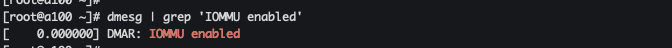
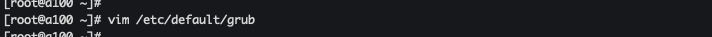
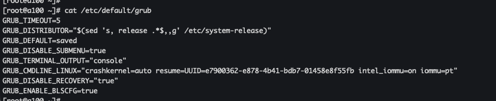
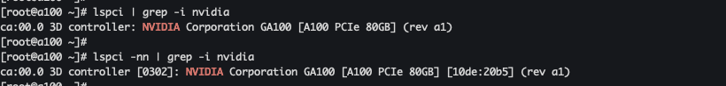
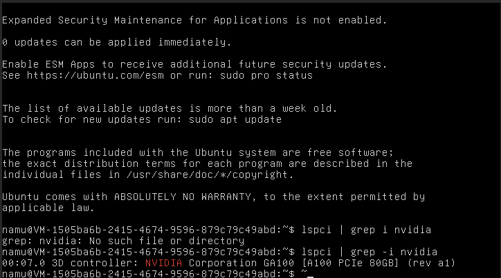
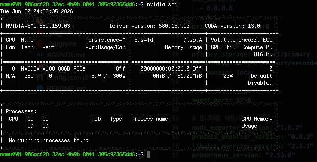

## Host 확인 {#host-확인 .j-제목-3}

**Infrastructure \> Hosts** 메뉴에서 호스트 상세 페이지의 **GPU** 탭에서 자동으로 등록된 디바이스를 확인할 수 있다. GPU가 모두 표시되는지 확인한다. 장치가 보이지 않으면 **Discover GPU devices** 버튼을 눌러 다시 조회한다.

{width="6.5777777777777775in" height="3.1805555555555554in"}

> 그림 ‑ KVM Host의 GPU 인식 확인

## GPU Card 등록 확인 {#gpu-card-등록-확인 .j-제목-3}

- **Configuration \> GPU Card Types** 메뉴에서 자동으로 등록된 디바이스를 확인할 수 있다.

{width="6.5777777777777775in" height="3.2083333333333335in"}

> 그림 ‑ GPU 카드 등록 확인

## GPU Compute Offering 생성 {#gpu-compute-offering-생성 .j-제목-3}

GPU를 지원하는 VM을 생성하기 위해서는 GPU 지원 가능한 Compute Offering을 생성해야 한다. Compute Offering을 추가할 때 GPU Card에서 등록된 디바이스를 선택하여 생성한다.

{width="6.5777777777777775in" height="3.2083333333333335in"}

> 그림 ‑ GPU Compute Offering 생성

- **GPU Card**: GPU Card Types에 등록된 디바이스를 선택한다.

- **GPU Profile**: passthrough 를 선택한다.

- **GPU Count**: VM 하나에 할당할 GPU 수를 입력한다. GPU 1장 VM과 여러 장 VM을 모두 제공하려면 GPU Count별로 Compute Offering을 따로 만든다. (예: 1장, 2장, 4장)

- **Dynamic scaling enabled**: GPU Passthrough VM은 실행 중 크기 변경을 지원하지 않으므로 끄는 것을 권장한다.

- **Root Disk**: GPU 드라이버와 CUDA를 설치할 수 있도록 최소 20GB, 권장 100GB 이상으로 한다.

- **Memory**: 사용할 GPU의 VRAM총합보다 높은 값을 입력한다.

GPU를 VM마다 1장씩 나눠 줄 수 없는 호스트(별도 안내)에는 GPU Count가 그 호스트의 GPU 수와 같은 Compute Offering만 사용한다. 다른 오퍼링으로 만든 VM은 시작에 실패할 수 있다.

## VM 생성 {#vm-생성 .j-제목-3}

앞에서 생성한 GPU Compute Offering을 선택해 인스턴스 생성을 요청한다. Root Disk가 작은 템플릿이라면 **Override root disk size** 로 크기를 늘린다.

{width="6.578133202099737in" height="3.2083333333333335in"}

> 그림 ‑ GPU VM 생성

## GPU PCI Passthrough 인식 확인 {#gpu-pci-passthrough-인식-확인 .j-제목-3}

GPU Compute Offering으로 생성한 VM에 접속한 후 lspci 명령을 실행하여, 물리 GPU 장치가 게스트 운영체제의 PCI 장치로 정상 전달되었는지 확인한다. GPU를 여러 장 할당한 VM은 할당한 수만큼 출력되어야 한다.

{width="6.5784722222222225in" height="0.41796806649168855in"}

> 그림 ‑ VM GPU PCI Passthrough 인식 확인

위 결과는 KVM 호스트의 NVIDIA A100 GPU가 해당 VM에 PCI Passthrough 방식으로 정상 연결되었음을 의미한다.

VM에 NVIDIA 드라이버와 nvidia-utils를 설치한 후 nvidia-smi 로 GPU 정보를 조회한다.

{width="6.46875in" height="3.3020833333333335in"}

> 그림 ‑ VM NVIDIA Driver 설치 확인

GPU 정보가 정상적으로 조회되면 GPU Passthrough 설정이 완료된 것이다.

## 주의 사항 {#주의-사항 .j-제목-3}

- GPU Passthrough VM은 라이브 마이그레이션을 할 수 없다. 호스트를 유지보수 모드로 전환하기 전에 해당 VM을 중지해야 한다.

- GPU Passthrough VM을 다른 호스트에서 재시작하려면 그 호스트에도 같은 GPU가 할당 가능한 상태로 남아 있어야 한다.

- namuVIRT는 VM을 배치할 때 호스트의 남은 GPU 수만 확인한다. GPU를 VM마다 나눠 줄 수 없는 호스트에 GPU VM이 두 대 이상 배치되면 두 번째 VM부터 시작에 실패한다.
