GPU Passthrough 를 지원하기 위한 시나리오이다. GPU Passthrough를 지원하기 위해서는 KVM 호스트에 관리자 권한으로 접속하여 GPU Passthrough를 지원하기 위한 OS 설정을 해야 한다.

## IMMOU 활성화 {#immou-활성화 .j-제목-3}

IOMMU가 활성화 되어있는지 확인한다.

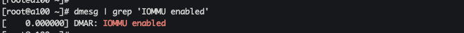{width="6.5777777777777775in" height="0.4722222222222222in"}

> 그림 ‑ KVM Host IOMMU 활성화 여부 조회

비활성화 상태라면 grub 파일의 "**GRUB_CMDLINE_LINUX_DEFAULT**"에 값을 추가한다.

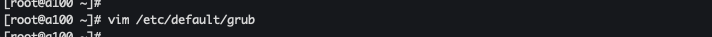{width="6.5777777777777775in" height="0.3472222222222222in"}

> 그림 ‑ grub 설정

설정 값은 Intel의 경우 \"intel_iommu=on\", AMD의 경우 \"amd_iommu=on\"로 작성한다. grub 파일 수정 후 "update-grub" 명령어로 변경 사항을 적용한다.

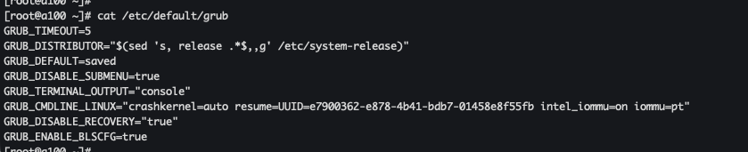{width="6.5777777777777775in" height="1.3472222222222223in"}

> 그림 ‑ grub 설정(GRUB_CMDLINE_LINUX_DEFAULT) 확인

## GPU 확인 {#gpu-확인 .j-제목-3}

Passthrough로 사용할 GPU의 ID와 PCI 주소를 확인한다.

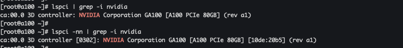{width="6.5777777777777775in" height="0.7916666666666666in"}

> 그림 ‑ GPU ID 및 PCI 주소 확인

## VFIO 드라이버 설정 {#vfio-드라이버-설정 .j-제목-3}

vfio 모듈이 로드되었는지 확인한다.

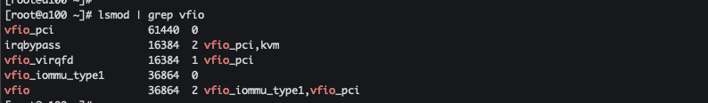{width="6.5777777777777775in" height="0.9583333333333334in"}

> 그림 ‑ vifo 드라이버 로드 확인

모듈이 없는 경우 "modprobe" 명령어로 모듈을 추가한다.

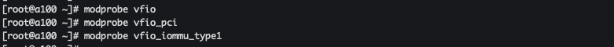{width="6.5777777777777775in" height="0.5in"}

> 그림 ‑ modprobe 를 이용한 vfio 드라이버 모듈 로드

RHEL 계열의 OS인 경우 재부팅 시 vfio 모듈이 자동으로 로드 될 수 있도록 설정을 추가한다.

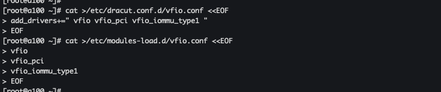{width="6.5777777777777775in" height="1.3888888888888888in"}

> 그림 ‑ RHEL 계열 재 부팅시 vifo 모듈 자동 로드 설정

GPU ID를 vfio-pci에 바인딩한다.

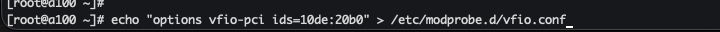{width="6.5777777777777775in" height="0.2916666666666667in"}

> 그림 ‑ GPU -- vifo PCI 바인딩

(선택) vifo-pci가 드라이버를 점유할 수 있도록 다른 선택지들을 블랙리스트 처리한다.

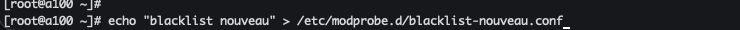{width="6.5777777777777775in" height="0.2638888888888889in"}

> 그림 ‑ vifo-pci 드라이버 점유를 위한 블랙리스트 처리

initramfs를 업데이트한다. Ubuntu의 경우 "update-initramfs -u" 명령어를 사용하고, RHEL 계열의 경우 "dracut -f" 명령어를 사용한다.

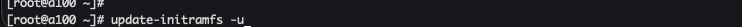{width="6.5777777777777775in" height="0.2361111111111111in"}

> 그림 ‑ Ubuntu Linux initramfs 업데이트

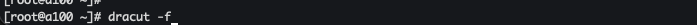{width="6.5777777777777775in" height="0.2361111111111111in"}

> 그림 ‑ Rocky Linux initramfs 업데이트

변경된 initramfs 를 업데이트 하기 위해서는 호스트를 재부팅해야 한다.

## 설정 확인 {#설정-확인 .j-제목-3}

pci 주소를 통해 vifo 모듈이 드라이버를 점유한 내용을 확인한다.

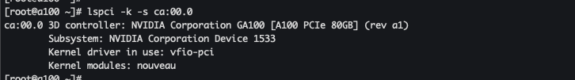{width="6.5777777777777775in" height="0.9166666666666666in"}

> 그림 ‑ vifo 모듈 드라이버 점유 확인

## Host 확인 {#host-확인 .j-제목-3}

사전에 설정한 호스트에 GPU가 인식되는지 확인한다.

**Infrastructure \> Hosts** 메뉴에서 호스트 상세 페이지의GPU 탭에서 자동으로 등록된 디바이스를 확인할 수 있다.

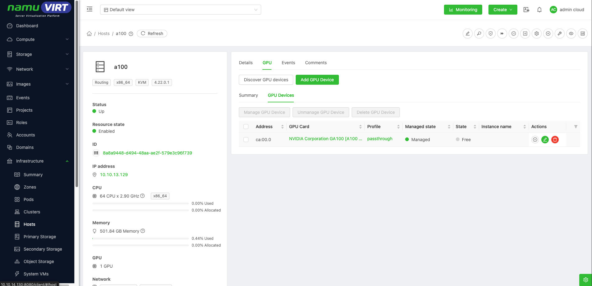{width="6.5777777777777775in" height="3.1805555555555554in"}

> 그림 ‑ KVM Host의 GPU 인식 확인

## GPU Card 등록 확인 {#gpu-card-등록-확인 .j-제목-3}

- **Configuration \> GPU Card Types** 메뉴에서 자동으로 등록된 디바이스를 확인할 수 있다.

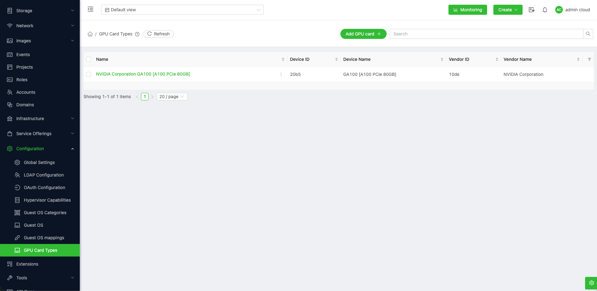{width="6.5777777777777775in" height="3.2083333333333335in"}

> 그림 ‑ GPU 카드 등록 확인

## GPU Compute Offering 생성 {#gpu-compute-offering-생성 .j-제목-3}

GPU를 지원하는 VM을 생성하기 위해서는 GPU 지원 가능한 Compute Offering을 생성해야 한다. Compute Offering을 추가할 때 GPU Card에서 등록된 디바이스를 선택하여 생성한다.

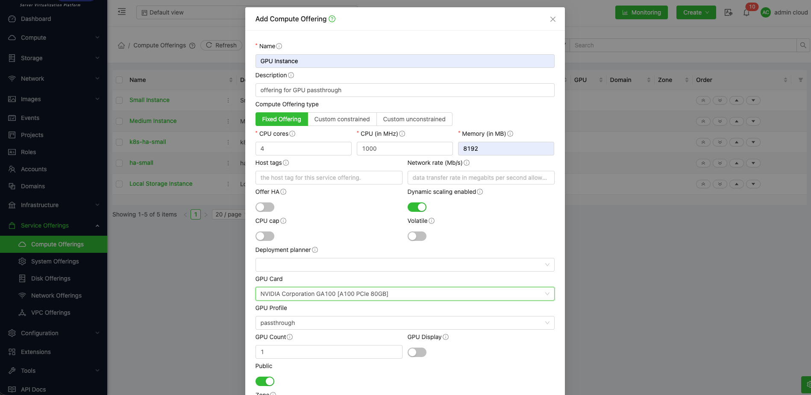{width="6.5777777777777775in" height="3.2083333333333335in"}

> 그림 ‑ GPU Compute Offering 생성

여기서 주의할 점은 GPU Driver 를 설치하기 위한 절절한 크기의 Root Disk Offering 을 선택해야 한다.

- 최소 20GB 이상 권장 100GB

## VM 생성 {#vm-생성 .j-제목-3}

GPU를 지원하는 가상머신을 생성하기 위해서는 앞에서 생성한 GPU Compute Offering 을 기반으로 인스턴스를 생성요청 하면 된다.

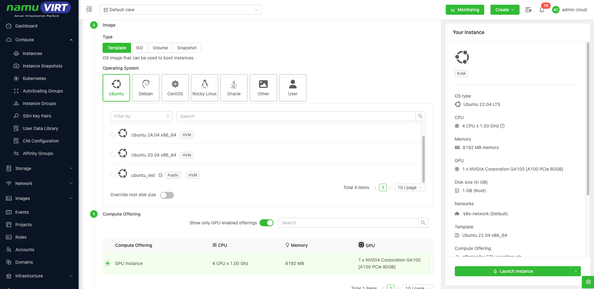{width="6.578133202099737in" height="3.2083333333333335in"}

> 그림 ‑ GPU VM 생성

## GPU PCI Passthrough 인식 확인  {#gpu-pci-passthrough-인식-확인 .j-제목-3}

GPU Compute Offering으로 생성한 VM에 접속한 후 lspci 명령을 실행하여, 물리 GPU 장치가 게스트 운영체제의 PCI 장치로 정상 전달되었는지 확인한다.

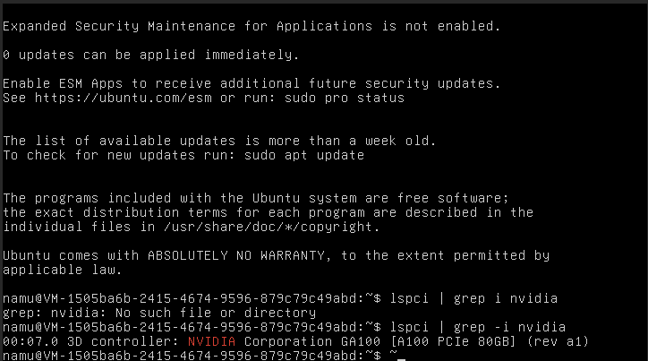{width="6.5784722222222225in" height="0.4736111111111111in"}

> 그림 ‑ VM GPU PCI Passthrough 인식 확인

위 결과는 KVM 호스트의 NVIDIA A100 GPU가 해당 VM PCI Passthrough 방식으로 정상 연결되었음을 의미한다.

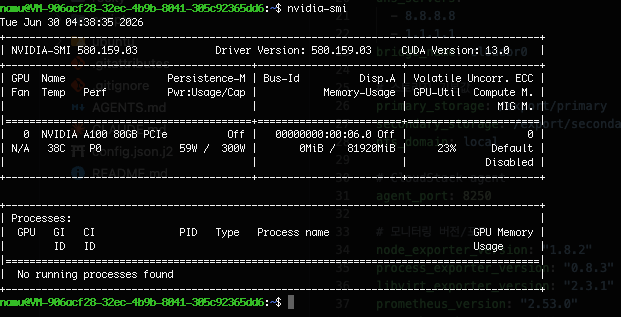{width="6.46875in" height="3.3020833333333335in"}

> 그림 ‑ VM NVIDIA Driver 설치 확인

위 사진은 nvidia driver 및 nvidia utils 를 설치한 후 nvidia-smi 를 이용해서 GPU 정보를 조회한 결과이다.

정상적으로 GPU 장치를 가져오는 것을 확인할 수 있다.
