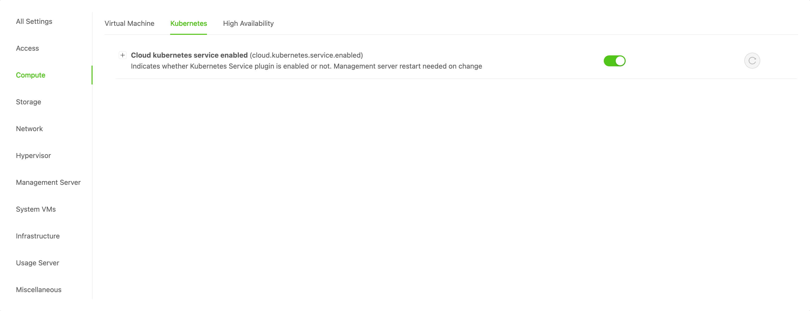
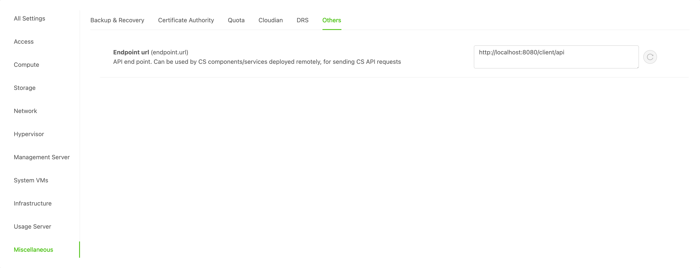
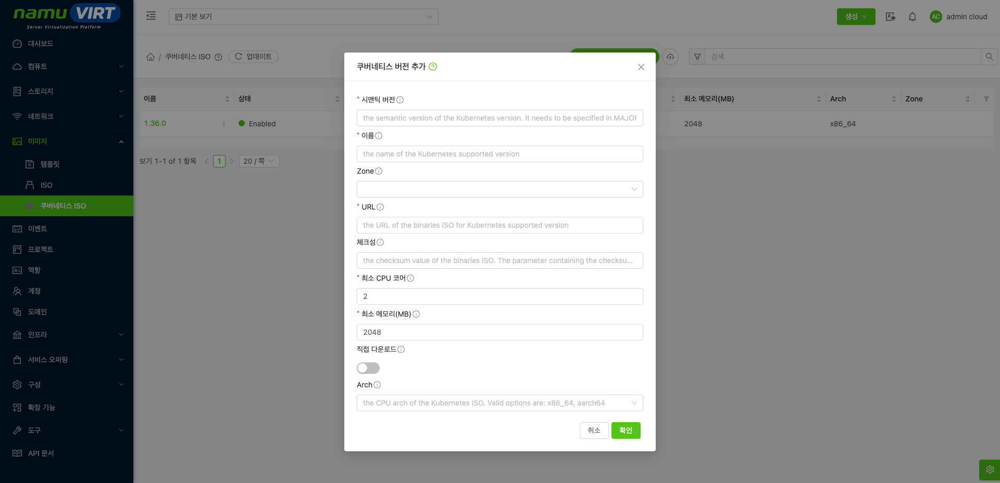
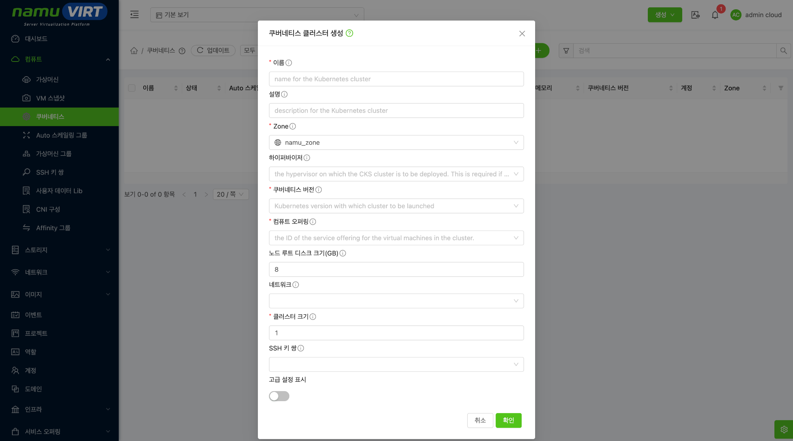

namuVIRT는 Kubernetes 클러스터 환경을 구성하기위한 기능을 제공한다. 클러스터를 구성하고 운영하기 위한 절차는 다음과 같다.

1.  Kubernetes 사용 설정

2.  Kubernetes ISO 템플릿 등록

3.  Guest Network 생성(선택)

4.  Compute Offering 생성

5.  Kubernetes Cluster 생성

6.  Kubernetes 운영

## Kubernetes 사용 설정  {#kubernetes-사용-설정 .j-제목-3}

- **글로벌 설정 \> Compute \> Kubernetes**에서 Kubernetes 기능 활성화

{width="6.5784722222222225in" height="2.529861111111111in"}

> 그림 ‑ Kubernetes 기능 활성화

- **글로벌 설정 \> Miscellaneous \> Other**에서 **endpoint.url** 설정 : 관리서버 주소 (예: http://\<management server ip:port or fqdn\>/client/api)

{width="6.5784722222222225in" height="2.529861111111111in"}

> 그림 ‑ endpoint.url 설정

## Kubernetes ISO 등록  {#kubernetes-iso-등록 .j-제목-3}

Kubernetes를 배포하고 관리할 수 있도록 제공하는 부팅 가능한 이미지를 등록할 수 있다. 부팅 가능한 이미지는 아래 링크에서 제공중이다.

### CKS ISO 다운로드 링크  {#cks-iso-다운로드-링크 .j-제목-4}

[클라우드스택 CKS ISO 이미지 다운로드 링크](https://download.cloudstack.org/cks/)

### Kubernetes ISO 등록 {#kubernetes-iso-등록-1 .j-제목-4}

Kubernetes [ISO 이미지를 등록하여 사용하면 된다. 이때 시맨틱 버전과 다운로드 링크에서 제공하는 버전이 일치해야 한다.]{.smallcaps}

[또한, 최소 CPU 코어와 최소 메모리 사이즈를 지정 가능하며 이는]{.smallcaps} Kubernetes 운영을 고려하여 지정해야 한다. 이 때 지정된 사이즈는 Kubernetes Cluster 생성 시 Compute Offering 을 선택하는 기준이 된다.

{width="6.578133202099737in" height="3.1805555555555554in"}

> 그림 ‑ Kubernetes ISO 등록

## Guest Network 등록 (선택) {#guest-network-등록-선택 .j-제목-3}

Kubernetes Cluster를 제공하기 위해서는 격리된 네트워크(isolated network)가 필요로 하다. 이는 Advanced network를 사용하는 Zone에서 사용 가능하다.

이때 생성된 isolated network는 Network Offering에서 Source NAT, DHCP, DNS, Load Balancer가 포함된 Offering을 이용해서 Network를 생성해야 한다.

Kubernetes Cluster를 생성할 때 네트워크를 지정하지 않으면 Kubernetes Cluster 전용 Network Offering을 namuVIRT에서 생성한다.

- **글로벌 설정 \> cloud.kubernetes.cluster.network.offering** 에 **DefaultNetworkOfferingforKubernetesService** 가 등록되어 있는 경우 CKS에 대한 네트워크를 자동으로 생성해 준다.

## Compute Offering 등록 {#compute-offering-등록 .j-제목-3}

Kubernetes Cluster를 구성하기 위한 Compute Offering을 구성한다. 이때 Compute Offering의 CPU와 Memory의 사이즈는 Kubernetes ISO 템플릿에서 지정한 CPU와 Memory 사이즈보다 커야 한다.

## Kubernetes Cluster 생성 {#kubernetes-cluster-생성 .j-제목-3}

{width="6.5784722222222225in" height="3.7762029746281716in"}

> 그림 ‑ Kubernetes Cluster 생성

Kubernetes Cluster를 구성하기 위한 Compute Offering을 구성한다. 이때 Compute Offering 의 CPU와 Memory의 사이즈는 Kubernetes ISO 템플릿에서 지정한 CPU와 Memory 사이즈보다 커야 한다.

Kubernetes Cluster 구성 시 HA 활성화를 하게 되면 마스터 노드 수와 외부 로드 밸런서 IP 주소를 설정할 수 있다. 외부 로드 밸런서는 공유네트워크에서 Kubernetes HA 를 사용할 때 사용하는 외부 로드 밸런서 IP 주소 이다. 고급 설정을 이용하여 제어 노드와 워커노드의 Compute Offering을 다르게 지정할 수 있다.

여기서 주의할 점은 노드 루트 디스크 크기이다. 목적에 맞춰 설정해 주어야 한다.

  ------------------------------------------------------------------------
  **용도**                 **최소 권장**           **안정적인 권장**
  ------------------------ ----------------------- -----------------------
  단순 PoC Control Plane   30GB                    50GB

  단순 PoC Worker          40GB                    50\~80GB

  운영 Control Plane       80GB                    100GB

  운영 Worker              100GB                   150\~200GB

  모니터링/로그 Worker     200GB                   
  ------------------------------------------------------------------------

  : 표 ‑ Kubernetes Cluster 노드 디스크 권장사양

## Kubernetes 운영 {#kubernetes-운영 .j-제목-3}

Kubernetes Cluster를 생성하면 상세 페이지에서 액세스 방법/가상머신/방화벽 설정/포트 포워딩 설정/로드밸런서 설정 등을 확인할 수 있다.

## Kubernetes Access {#kubernetes-access .j-제목-3}

Kubernetes Cluster를 생성완료 하면 Kubernetes API를 사용할 수 있다
