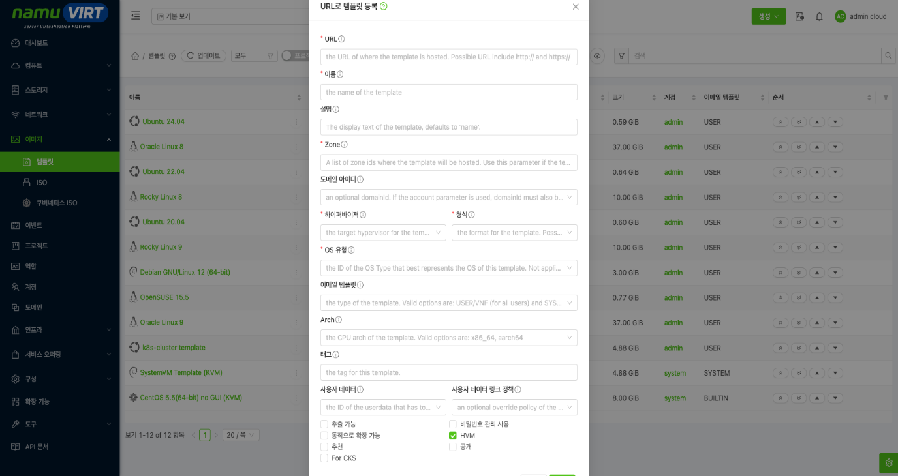
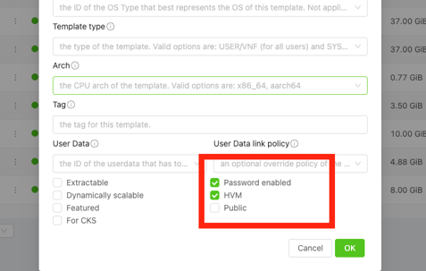
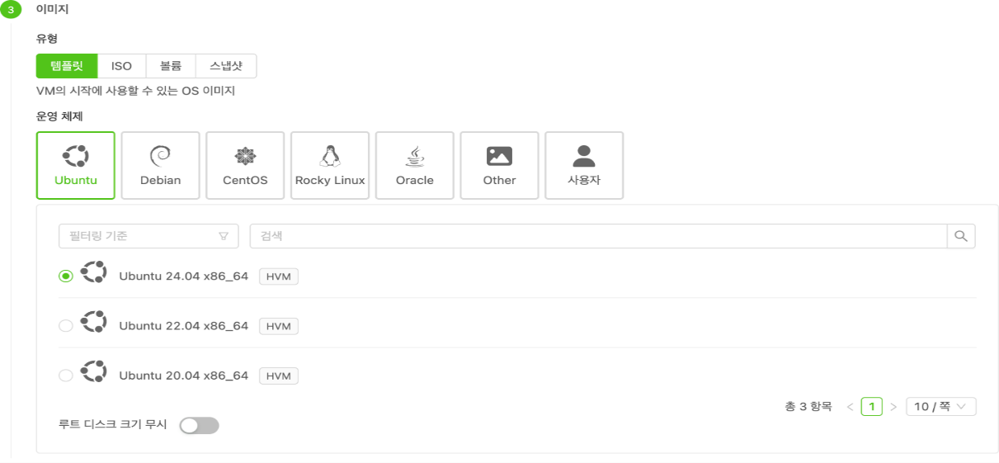
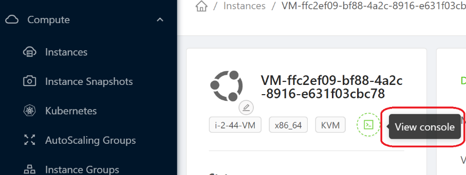

이 문서는 Template을 통해 Instance 생성 직후 사용할 수 있는 접속 계정을 준비하고 검증하는 절차를 다룬다.

Template(템플릿)은 운영체제가 미리 설치된 "디스크 이미지(원본)"이고, Instance(인스턴스)는 그 Template으로 만들어 실제 실행되는 가상 서버이다. 아래 순서대로 진행한다.

  ----------------------------------------------------------------------------
  ① Template 준비(생성) → ② Template으로 Instance 생성 → ③ View Console 접속
  ----------------------------------------------------------------------------

  ----------------------------------------------------------------------------

## Template 준비(생성) {#template-준비생성 .j-제목-3}

인스턴스의 바탕이 되는 OS 이미지를 등록하고, 인스턴스 접속에 쓸 **비밀번호 관리 정책**을 정한다. 이미 알맞은 Template이 있으면 이 단계는 건너뛰어도 된다.

1.  좌측 메뉴에서 **이미지(Images) \> 템플릿(Templates)**로 이동한 뒤 **템플릿 등록**을 클릭한다.

2.  이름·설명, 외부 이미지 **URL**(또는 파일 업로드), **운영체제 유형**, **Zone** 등을 입력한다.

3.  아래 **비밀번호 관리 정책**(방식 A 또는 B) 중 하나를 정한다.

4.  입력을 마치면 **등록**한다. 템플릿 목록에서 상태가 **준비 완료(Ready)**로 바뀌면 사용할 수 있다. (URL 등록 시 다운로드에 시간이 걸릴 수 있다.)

{width="6.260416666666667in" height="3.3125in"}

> 그림 ‑ URL 기반 템플릿 등록

> URL 기반 템플릿 등록

## View Console 접속 계정 비밀번호 관리 정책 {#view-console-접속-계정-비밀번호-관리-정책 .j-제목-3}

> Instance의 View Console 접속 계정 관리 방식은 세가지로 제공된다. Template에 계정과 비밀번호를 준비해 Web Console 또는 비밀번호 기반 로그인에 사용하는 방식과, Template 자체의 Password enabled 설정을 통해 생성할 때 초기화를 해주는 방식으로 구성된다.

  -------------------------------------------------------------------------------------------------------------------
         **방식**        **사용 목적**                         **Template 요구 조건**
  ---------------------- ------------------------------------- ------------------------------------------------------
     Password Enabled    Instance 생성 시 초기 비밀번호 발급   \'cloud-init\' 비밀번호 처리와 필요한 조회 도구 준비

   커스텀 계정/비밀번호  Web Console에서 즉시 로그인           이미지 내부 계정, 비밀번호, Shell, sudo 권한 준비

       SSH Key Pair      공개키                                
  -------------------------------------------------------------------------------------------------------------------

  : 표 ‑ Console 계정 비밀번호 관리 정책

1.  **Password Enable 방식**

{width="4.96875in" height="1.5208333333333333in"}

> 그림 ‑ 템플릿 이미지 등록 시 패스워드 사용 옵션 활성화

템플릿 등록 시 비밀번호 사용(Password Enabled) 옵션을 선택한다.

이 템플릿으로 인스턴스를 만들면 초기 비밀번호가 자동으로 발급되어 생성 직후 화면에 표시된다.

**이 기능은 cloud-init 방식로 작동하기 때문에 Template가 되는 OS에 wget이 기본 요구되며, 없으면 비밀번호가 초기화되지 않는다.**

  ----------------------------------------------------------
  **OS**                     **기본 계정**
  -------------------------- -------------------------------
  Ubuntu                     \'ubuntu\'

  Rocky Linux                \'rocky\'

  CentOS 계열                \'centos\'
  ----------------------------------------------------------

  : 표 ‑ OS 별 기본 생성 계정 정보

Rocky Linux 8 기본 이미지에서는 cloud-init이 비밀번호를 가져오는 과정에서 wget이 존재하지 않아, 기본 제공 이미지 파일로는 실패한다.

> \$ Running command \[\'wget\', \'\--quiet\', \'\--tries\', \'3\', \'\--timeout\', \'20\',\
> \$ \'\--output-document\', \'-\', \'\--header\', \'DomU_Request: send_my_password\',\
> \$ \'10.10.14.1:8080\'\]\
> \
> \$ Failed to fetch password from virtual router 10.10.14.1\
> \$ FileNotFoundError: \[Errno 2\] No such file or directory: b\'wget\'
>
> 이 결과는 Password Enabled 설정만으로 기능 동작을 보장할 수 없음을 보여준다. Template 이미지 내부에 비밀번호 조회에 필요한 도구와 cloud-init 구성이 함께 준비돼 있어야 한다.

2.  **커스텀 계정/비밀번호**

이 방식은, Template로 쓰일 이미지 파일 자체에 계정과 비밀번호를 먼저 주입하고, 이를 namuVIRT에 업로드하여 이를 이용하는 방식이다. 이는 **사용자의 환경에 맞춰진 설정을 기반으로 진행**되어야 한다.

아래 절차는 커스텀 Template 구성 방법을 설명하기 위한 예시다. 설정을 통해 계정 정보를 추가하고, namuVIRT에 업로드하는 일련의 과정들을 다룬다.

> 1\) 실제 작업에서는 사용하는 OS 이미지, 계정 정책, 패키지 저장소, 보안 기준에 맞게 명령과 값을 조정한다. 이 예시에서는 Ubuntu 이미지에 검증용 계정을 추가하고 비밀번호를 설정한다.
>
> \$ docker run \--rm -it \\\
> \--privileged \\\
> \--platform linux/amd64 \\\
> -v \"\$PWD:/work\" \\\
> ubuntu:24.04 bash

2)  컨테이너 안에서 이미지 가공 도구를 설치한다.

> \$ apt-get update\
> \
> \$ DEBIAN_FRONTEND=noninteractive apt-get install -y \\\
> guestfs-tools \\\
> qemu-utils \\\
> linux-image-generic
>
> 3\) 원본 이미지를 복사해 별도 작업 파일을 만든다.
>
> \$ cp -a ubuntu-24.04-server-cloudimg-amd64.img \\\
> ubuntu-24.04-server-cloudimg-amd64-custom.img
>
> 4\) virt-customize로 관리자 계정과 Ubuntu 기본 계정을 준비한다.
>
> \$ export LIBGUESTFS_BACKEND=direct\
> \$ ADMIN_USER=\"\<ADMIN_USER\>\"\
> \$ PASSWORD=\"\<PASSWORD\>\"\
> \
> \$ virt-customize -a ubuntu-24.04-server-cloudimg-amd64-custom.img \\\
> \--run-command \"id \${ADMIN_USER} \>/dev/null 2\>&1 \|\| useradd -m -s /bin/bash \${ADMIN_USER}\" \\\
> \--run-command \'id ubuntu \>/dev/null 2\>&1 \|\| useradd -m -s /bin/bash ubuntu\' \\\
> \--password \"\${ADMIN_USER}:password:\${PASSWORD}\" \\\
> \--password \"ubuntu:password:\${PASSWORD}\" \\\
> \--run-command \"usermod -aG sudo \${ADMIN_USER}\" \\\
> \--run-command \'usermod -aG sudo ubuntu\'
>
> 5\) 이미지 내부 계정을 확인한다.
>
> \$ virt-cat -a ubuntu-24.04-server-cloudimg-amd64-custom.img /etc/passwd \\\
> \| grep -E \"\^(\${ADMIN_USER}\|ubuntu):\"

##  Template으로 Instance 생성 {#template으로-instance-생성 .j-제목-3}

등록된 Template을 골라 가상 서버(인스턴스)를 만든다.

1.  컴퓨트(Compute) \> 인스턴스(Instances)에서 인스턴스 추가를 클릭한다.

2.  마법사에서 소유 계정·도메인을 선택한다. (보통 기본값 사용)

3.  배포할 Zone(영역)을 선택한다.

4.  이미지 단계에서 유형을 템플릿으로 두고, 운영체제와 사용할 Template을 선택한다.

5.  컴퓨트 오퍼링(CPU·메모리)과 네트워크, 인스턴스 이름을 지정한 뒤 인스턴스 생성을 클릭한다.

{width="5.5in" height="2.5520833333333335in"}

> 그림 ‑ 이미지 템플릿 선택

**\* 완료 확인:** 잠시 후 인스턴스 상태가 **Running(실행 중)**으로 바뀌면 생성이 완료된다.

##  콘솔(View Console) 접속 {#콘솔view-console-접속 .j-제목-3}

생성한 인스턴스에 웹 브라우저로 바로 접속한다. (인스턴스가 Running 상태여야 한다.)

1.  인스턴스(Instances) 목록에서 접속할 인스턴스를 클릭해 상세 화면을 연다.

2.  상세 화면 상단의 작업 아이콘에서 콘솔 보기(View Console)를 클릭한다.

{width="4.09375in" height="1.5462248468941382in"}

> 그림 ‑ VM Console 접속

3.  새 창에 Linux 웹 콘솔(터미널)이 열린다. 여기에 계정과 비밀번호로 로그인한다.
