namuVIRT는 인스턴스를 고가용성으로 활성화하여 지정할 수 있도록 지원한다. 기본적으로 모든 VR(Virtual Router)와 Elastic LB Instance(Load Balancing Instance)는 자동으로 HA를 활성화하여 구성된다.

HA 활성화가 된 인스턴스는 관리대상 호스트의 장애를 감지하고 동일한 가용영역 내 인스턴스를 자동으로 재시작 한다. 이때 동일한 인스턴스가 동시에 실행되는 일이 없도록 보수적인 정책을 유지한다.

HA 기능은 iSCSI 또는 NFS 스토리지(Shared Storage)와 함께 작동하며 Local Storage는 지원하지 않는다.

**[HA 기능을 검증하기 위해서는 동일한 클러스터 내에 두 개 이상의 호스트가 존재해야 한다.]{.smallcaps}**

## HA 기능 활성화 {#ha-기능-활성화 .j-제목-3}

HA 기능을 활성화 하기 위해서는 글로벌 설정 또는 Zone 설정에서 활성화가 가능하다.

- **Configuration \> Global Setting \> Compute \> Virtual Machine**에서 **HA(vm.ha.enable)** 기능 활성화

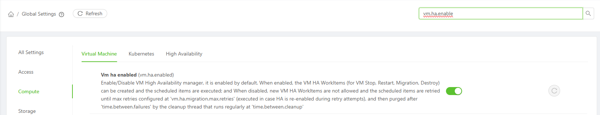{width="6.5784722222222225in" height="1.2715277777777778in"}

> 그림 ‑ 전역설정 VM HA 기능 활성화

- **Infrastructure \> Zones \> Zone Dtails \> Settings Tab** 에서 **HA(vm.ha.enable)** 기능 활성화

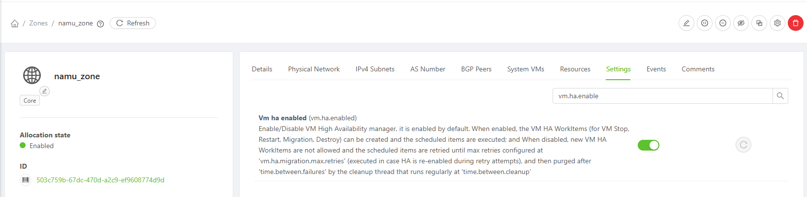{width="6.5784722222222225in" height="1.6166666666666667in"}

> 그림 ‑ Zone 별 VM HA 기능 활성화

## HA Compute Offering 생성  {#ha-compute-offering-생성 .j-제목-3}

HA 기능을 사용하기 위해서는 Compute Offering을 생성할 때 HA 기능을 활성화해주어야 한다.

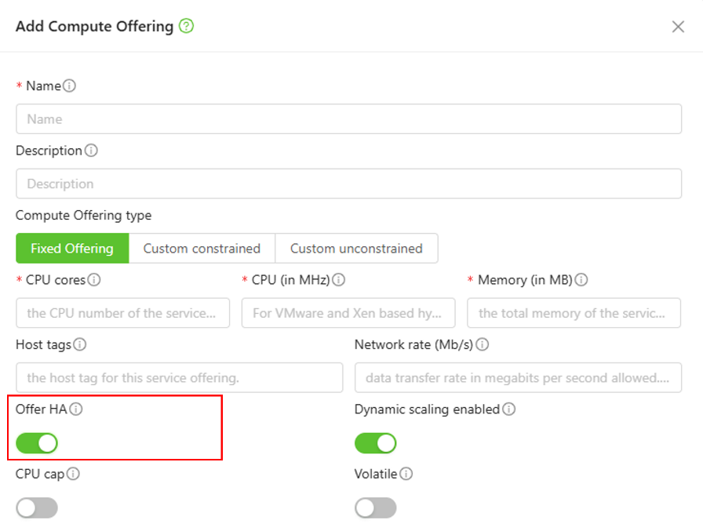{width="4.060974409448819in" height="3.03125in"}

> 그림 ‑ HA Compute Offering 생성 - Offer HA 활성화

## HA VM 생성 {#ha-vm-생성 .j-제목-3}

HA Compute Offering을 기반으로 가상머신을 생성한다.

이렇게 생성된 가상머신은 호스트가 장애 발생시 동일한 클러스터의 다른 호스트에서 재시작 된다.

## Dedicated HA {#dedicated-ha .j-제목-3}

Dedicated HA는 HA 전용 호스트를 지정하기 위해 사용된다. 예를 들어 KVM A, B, C가 있다고 가정하였을 때 KVM C 가 Dedicated HA 호스트 라고 지정되어 있으면 KVM A 또는 B에서 장애가 발생되었다고 판단되면 namuVIRT는 KVM C에 재생성 요청을 하게 된다.

Dedicated HA Host를 구성하기 위해서는 tag 기반으로 동작하며, **글로벌 설정에 Tag 지정**과 **Host에 Tag 지정**을 해야 한다.

- **Configuration \> Global Setting \> Compute \> High Availability**에서 **HA Tag(ha.tag)** 지정

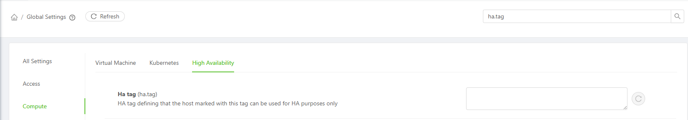{width="6.5784722222222225in" height="1.1534722222222222in"}

> 그림 ‑ Dedicated HA Tag 설정

**[참고:HA Tag를 지정하면 Management서버를 재시작 해야 한다.]{.smallcaps}**

HA Tag를 지정한 다음 호스트에 Tag를 추가하면 Dedicated HA Host 구성이 완료된다.

### Dedicated HA 구성 시 유의 사항 {#dedicated-ha-구성-시-유의-사항 .j-제목-4}

ha.tag를 지정하고 호스트에 해당 태그를 부여하면 그 호스트는 HA 재시작 전용 호스트가 된다. 이에 따라 평상시 배치 동작에 다음과 같은 제약이 함께 발생하게 된다

  ----------------------------------- ----------------------------------------------------------------------
  **제약사항**                        **설명**

  HA 재시작                           장애 발생 시 HA 태그가 지정된 호스트에서 인스턴스가 재 시작된다.

  신규 인스턴스 배치                  HA 태그가 지정된 호스트에는 자동으로 배치되지 않는다.

  수동 마이그레이션                   인스턴스 이동 대상 목록에 HA 태그가 지정된 호스트가 표시되지 않는다.
  ----------------------------------- ----------------------------------------------------------------------

  : 표 ‑ Dedicated HA 구성 시 제약사항

즉, Dedicated HA 호스트는 평상시에는 비워두고 장애 발생 시에만 사용하는 예비 호스트로 동작한다.

여기서 주의할 점은 호스트가 2대인 구성에서 1대를 Dedicated HA 호스토로 지정하면 나머지 1대에 있는 인스턴스를 이동할 대상이 없다. 따라서 **3대 이상의 호스트 구성시에만 Dedicated HA 적용을 권장**한다.

## HA 구성을 위한 ceph 스토리지 구성 {#ha-구성을-위한-ceph-스토리지-구성 .j-제목-3}

### ceph 운영 정보 사전 확인 {#ceph-운영-정보-사전-확인 .j-제목-4}

ceph 대시보드 화면에서 이상 유무를 확인한다.\
(\*Status또는 Inventory에 빨강, 노랑이 있는 경우 ceph 담당자 점검 요청)

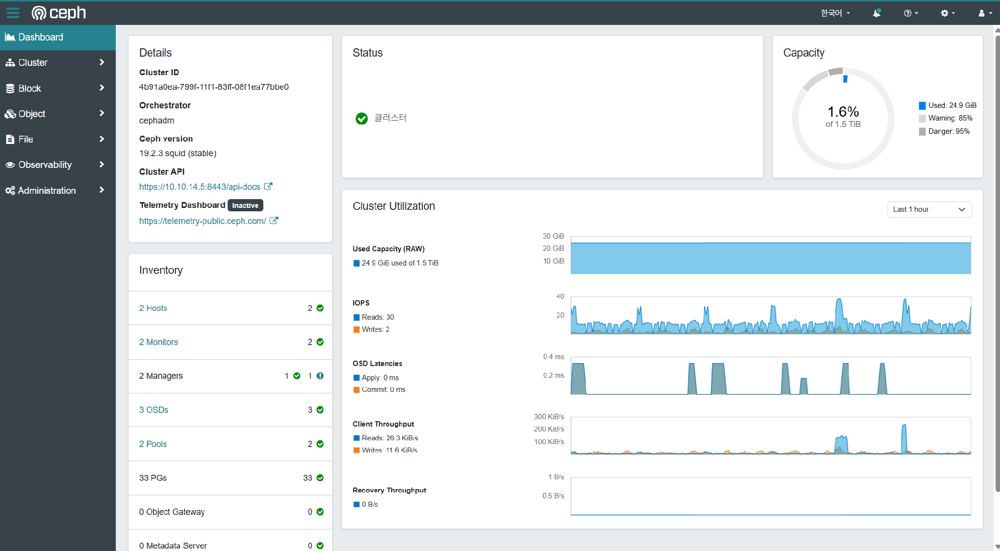{width="6.625in" height="3.3125in"}

> 그림 ‑ ceph 대시보드

+--------------------------+----------------------+---------------------------------------------------------------+
| **Primary Storage 항목** | **ceph 메뉴 경로**   | **확인 방법**                                                 |
+:========================:+======================+===============================================================+
| RADOS Monitor            | Cluster \> 모니터    | Quorum에 등록된 사용 IP Address.                              |
+--------------------------+----------------------+---------------------------------------------------------------+
| RADOS Pool               | Cluster \> 데이터 풀 | application_metadata 가 rdb로 지정된 이름.                    |
+--------------------------+----------------------+---------------------------------------------------------------+
| RADOS User               | Administration\      | mon: profile rbd, osd: profile rbd pool=\<RADOS Pool\> 대상자 |
|                          | \> Ceph Users        |                                                               |
|                          |                      | \*client.cloustack 인 경우 cloustack이 이름                   |
+--------------------------+----------------------+---------------------------------------------------------------+
| RADOS Secret             | Administration\      | Create 시에만 UI에서 확인 수 있음.                            |
|                          | \> Ceph Users        |                                                               |
|                          |                      | 기록하지 않은 경우 ceph 서버 콘솔명령어로 확인                |
|                          |                      |                                                               |
|                          |                      | \> sudo ceph auth get-key client.cloudstack                   |
+--------------------------+----------------------+---------------------------------------------------------------+

: 표 ‑ namuVIRT Priamry Storage 등록을 위한 ceph 값 확인 방법

### ceph RDB Primary Storage 신규 등록 {#ceph-rdb-primary-storage-신규-등록 .j-제목-4}

**Infrastructure → Primary Storage → Add Primary Storage** 클릭한다.

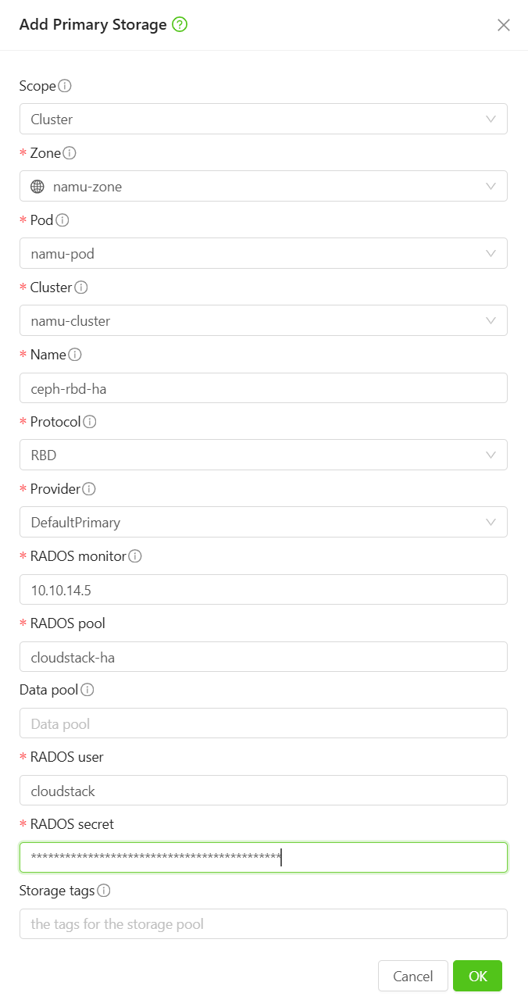{width="3.4091251093613297in" height="6.454907042869642in"}

> 그림 ‑ ceph primary storage 추가

사전에 ceph에서 확인된 정보를 입력하여 Primary Storage를 추가 후 State가 Up 상태인지 확인한다

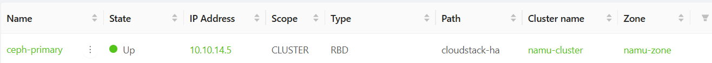{width="6.5784722222222225in" height="0.5895833333333333in"}

> 그림 ‑ ceph primary storage 추가 후 State 확인

### Ceph Primary Storage 등록 정보 수정(변경 관리) {#ceph-primary-storage-등록-정보-수정변경-관리 .j-제목-4}

RBD Primary Storage 는 접속 정보(Monitor/Pool/User/Secret)와 Scope/Protocol 을 직접 수정할 수 없다.

이 값을 바꾸려면 삭제 후 재등록해야 한다.

\* 주의 사항 : 접속 정보를 변경하는 경우 볼륨이 남아 있으면 삭제할 수 없다.\
먼저 볼륨을 다른 Primary 로 마이그레이션하여 삭제 대상 ceph의 의존성을 제거해야 삭제가 가능하다.

(Storage → Volumes 목록에서 Storage 필드에서 ceph 의존성 확인 가능)

### ceph RDB의 고가용성(HA) 설정 {#ceph-rdb의-고가용성ha-설정 .j-제목-4}

ceph RDB 스토리지를 이용하여 고가용성(HA)를 구성하는 경우 namuVIRT-Management 서버가 호스트를 Down으로 확정하지 못해 자동 HA 가 동작하지 않는다.

NFS를 공유 스토리지를 추가로 공유하여 HA가 동작하도록 설정이 필요하다.

\*참고 : [[https://docs.cloudstack.apache.org/en/latest/adminguide/reliability.html#ha-enabled-instances]{.underline}](https://docs.cloudstack.apache.org/en/latest/adminguide/reliability.html#ha-enabled-instances)

### 하트비트 풀 공유 NFS 구성 {#하트비트-풀-공유-nfs-구성 .j-제목-4}

VM 디스크는 모든 호스트가 함께 여는 Ceph RBD(공유 블록 스토리지)에 저장된다.

KVM HA는 별도의 NFS 하트비트 풀에 각 호스트가 하트비트 파일을 기록·갱신하여 HA 기능 활성화를 지원한다

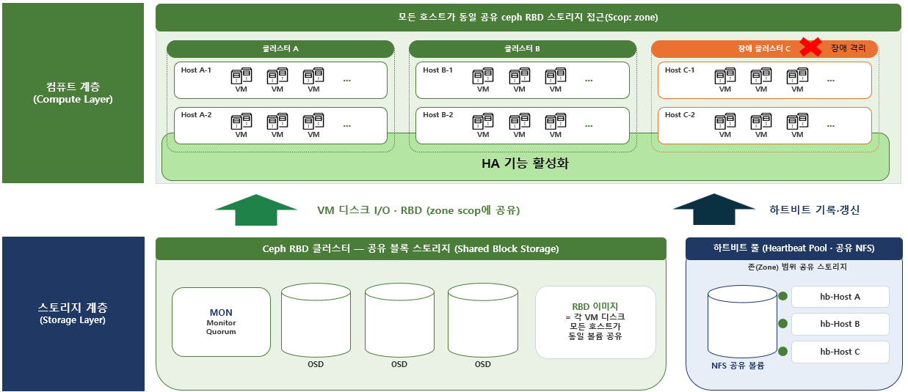{width="5.452174103237096in" height="3.008695319335083in"}

> 그림 ‑ KVM 호스트 ceph RBD 클러스터 및 하트비트 스토리지 풀 구성도

### 하트비트 풀 Primary Storage 추가 {#하트비트-풀-primary-storage-추가 .j-제목-4}

Infrastructure → Primary Storage → Add Primary Storage 클릭한다.

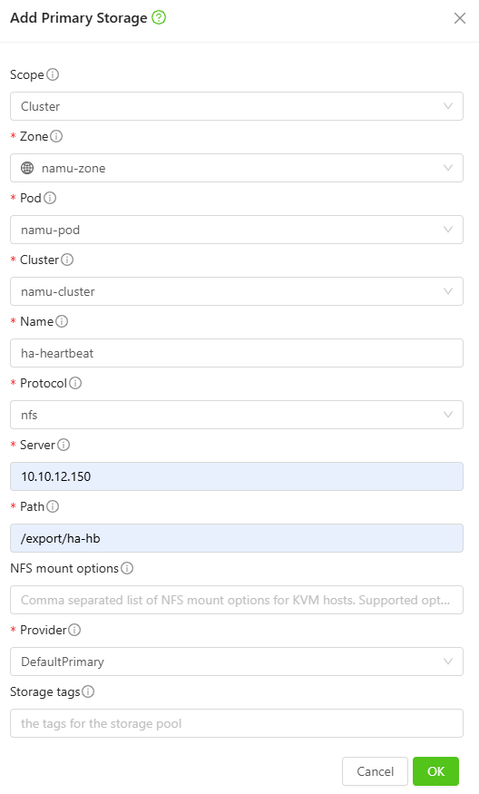{width="3.1655905511811024in" height="4.336537620297463in"}

> 그림 ‑ 하트비트 풀 Primary Storage 추가

Path에 입력하는 Storage은 하트비트용 풀 스토리지로만 사용한다면 1GB이하의 적은 용량으로 할당 가능하다.

\* 단 Ceph RBD 전용 환경에서 VM마이그레이션 하려면 NFS/로컬 Primary가 필요한데(RBD는 변환 직접 대상 불가), 이 하트비트 NFS를 변환 임시 Primary로 겸용할 수도 있다.

이 경우 변환 산출물 용량만큼 커야 하며, 변환 후 볼륨을 RBD로 옮기고 정리해 다시 하트비트 전용으로 사용 권장

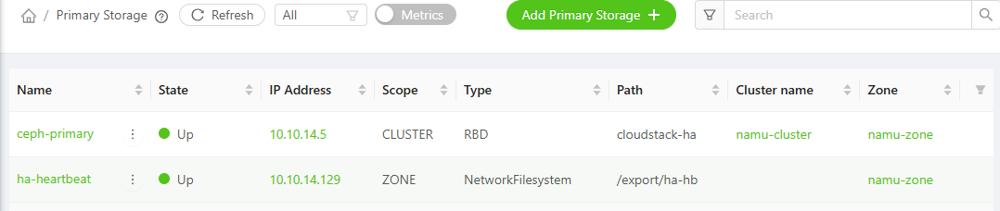{width="6.5784722222222225in" height="1.3909722222222223in"}

> 그림 ‑ ceph 하트비트 primary storage 추가 후 State 확인

### 스토리지 태그 지정 {#스토리지-태그-지정 .j-제목-4}

하트비트용 NFS 풀을 추가하면 Primary Storage가 두 개 이상이 된다. 이때 Compute Offering에 스토리지 태그를 지정하지 않으면 인스턴스 볼륨이 어느 풀에 생성될지 보장되지 않는다.

스토리지 태그가 지정되지 않은 경우 조건을 만족하는 모든 풀이 후보가 되며, 글로벌 설정 volume.allocation.algorithm 값에 따라 선택 순서가 정해진다. 기본값인 random인 경우 무작위로 선택된다.

따라서 ceph를 주 스토리지로 사용하는 경우 아래와 같이 스토리지 태그를 지정해야 한다.

- Infrastructure \> Primary Storage \> ceph 풀 : 스토리지 태그에 ceph를 지정한다.\
  (하트비트용 NFS 풀 : 스토리지 태그를 지정하지 않는다.)

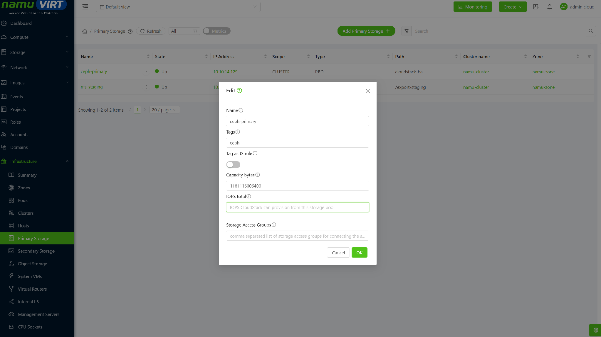{width="6.5784722222222225in" height="2.9583333333333335in"}

> 그림 ‑ Primary Storage ceph 풀 테그 지정

**Service Offerings \> Compute Offering** : Storage tags에 ceph를 지정한다.

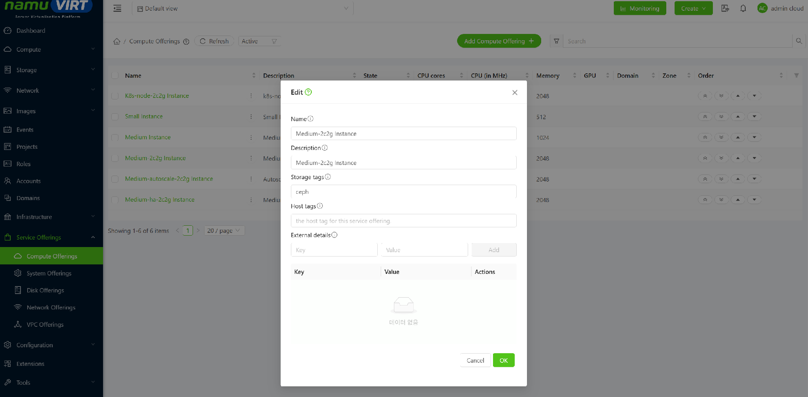{width="6.5784722222222225in" height="3.2333333333333334in"}

> 그림 ‑ Compute Offering ceph 풀 태그 지정

\* 주의 사항 : 기존에 스토리지 태그 없이 생성한 Offering이 남아 있으면, 해당 Offering으로 생성한 인스턴스는 계속 무작위로 배치된다. 기존 Offering에도 소급하여 태그를 지정하거나 사용을 중단해야 한다.

이미 다른 풀에 생성된 볼륨은 인스턴스를 정지한 후 볼륨 마이그레이션으로 ceph 풀로 이동한다.
