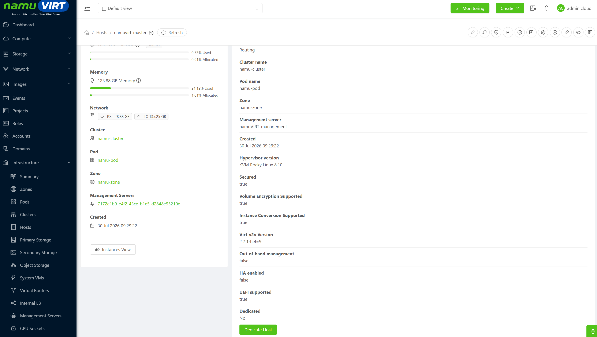
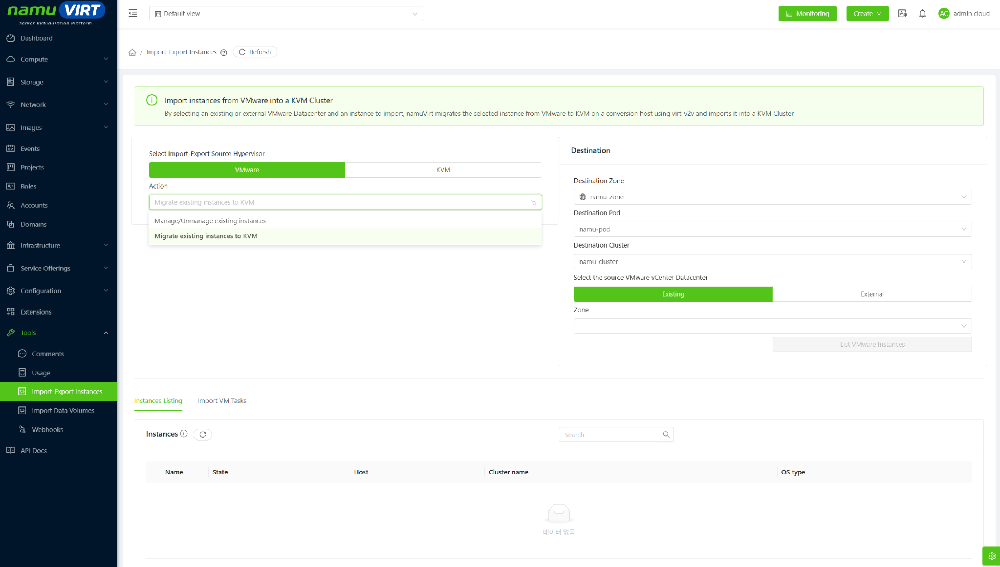
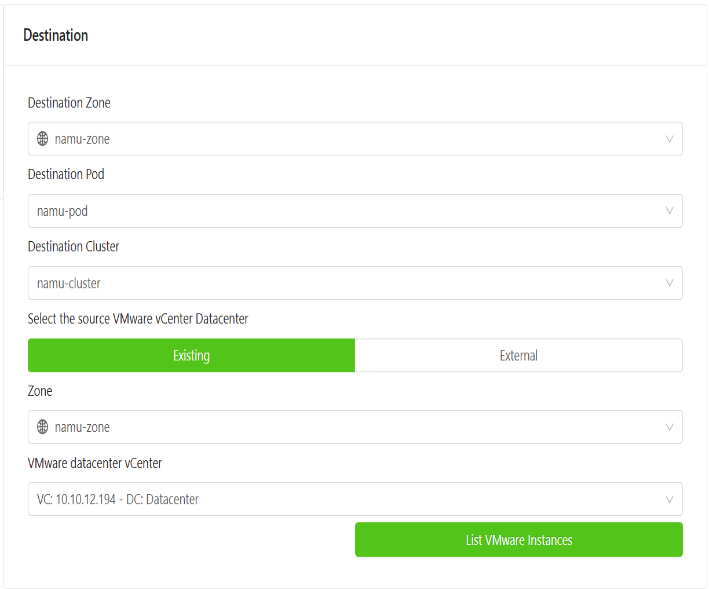
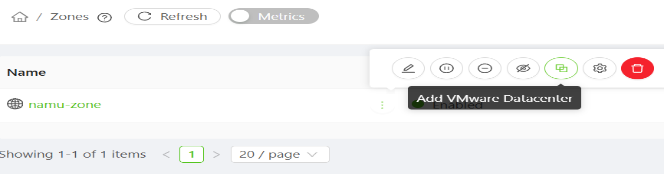
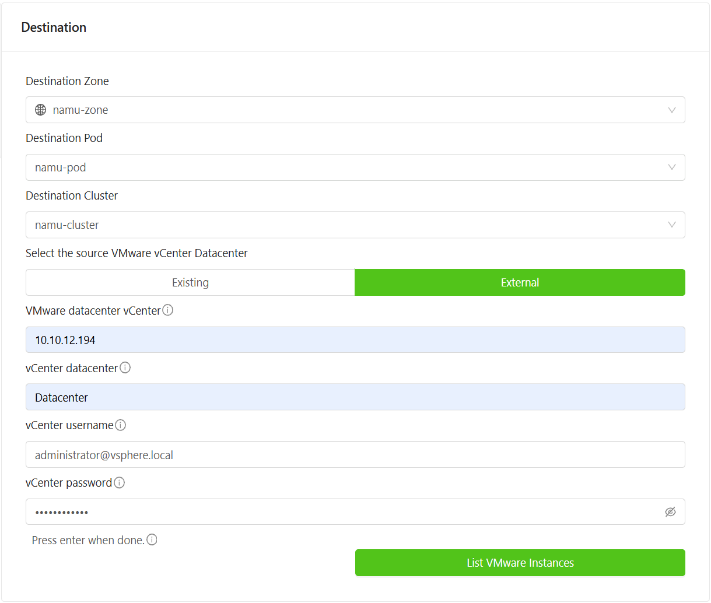
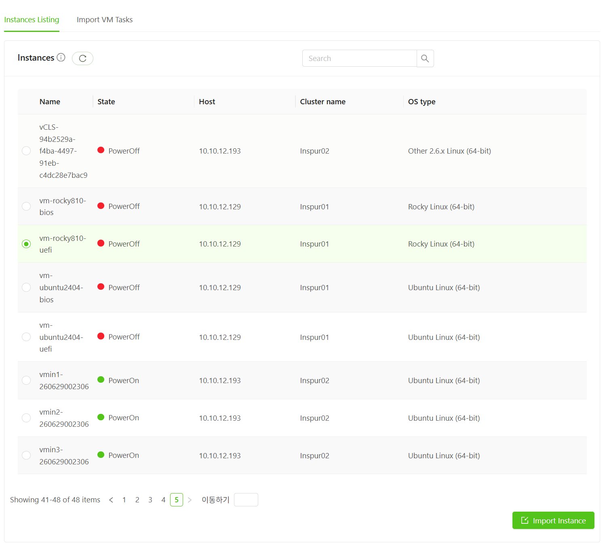
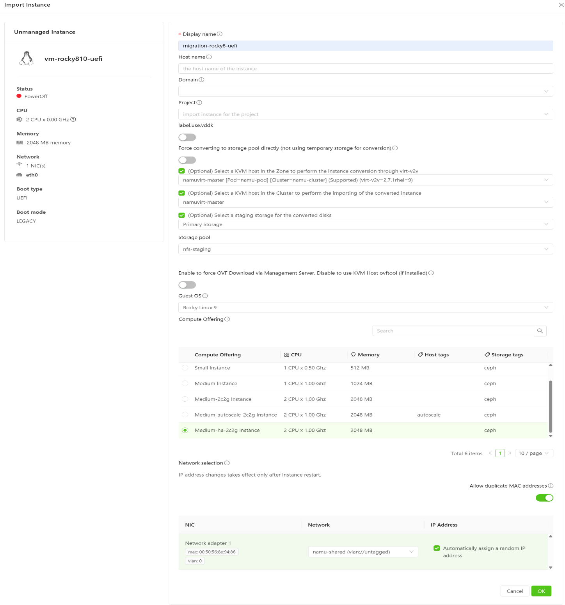
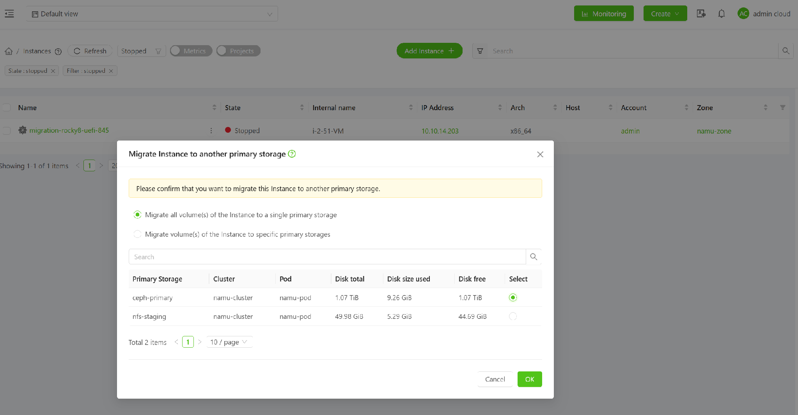

인스턴스 가져오기·내보내기는 외부 VMware 또는 namuVIRT 클러스터의 인스턴스를 가져오거나 내보내는 기능이다.

이 문서는 그중 VMware 인스턴스를 KVM으로 마이그레이션 하는 기능을 다룬다. namuVIRT는 내부적으로 virt-v2v를 사용하여 디스크 형식 변환과 드라이버 교체를 자동으로 수행하므로, 관리자는 화면에서 대상과 옵션을 지정하면 된다.

## 사전 환경 점검 {#사전-환경-점검 .j-제목-3}

virt-v2v는 변환 성공 여부를 좌우하는 가장 중요한 점검 항목이다. namuVIRT 설치 시 자동으로 설치되지 않으므로 변환 호스트에 직접 설치한 뒤 정상 인식 여부를 확인해야 한다.

- **인프라(Infrastructure) → 호스트(Hosts) → 대상 호스트 → 상세 virt-v2v Version** 항목 확인

{width="6.5784722222222225in" height="3.7215277777777778in"}

> 그림 ‑ virt-v2v 설치된 Host 확인

\* virt-v2v 가 설치되지 않은 호스트에는 이 항목 자체가 표시되지 않는다.

## 변환 호스트 필수 패키지 설치 {#변환-호스트-필수-패키지-설치 .j-제목-3}

namuVIRT 에이전트는 virt-v2v를 비롯한 변환 도구를 의존성으로 설치하지 않으므로, 변환을 수행할 KVM 호스트(변환 호스트)에 관리자가 직접 설치해야 한다. 특히 ovftool, VDDK는 VMware(Broadcom) 라이선스 정책에 따라 namuVIRT 패키지에 포함되지 않으므로 Broadcom에서 별도로 내려 받아 설치한다.

+--------------+-----------------------------------+--------------------------------------------+---------------------------------------+
| **패키지**   | **용도**                          | **필요 조건**                              | **미설치 시 영향**                    |
+:============:+===================================+============================================+=======================================+
| virt-v2v     | 디스크 형식 변환(VMDK → QCOW2)    | 필수 (모든 변환)                           | 변환 실패                             |
|              |                                   |                                            |                                       |
|              | virtio 드라이버 주입              | ※ 자동 설치되지 않음                       | virt-v2v Version 항목 미표시          |
+--------------+-----------------------------------+--------------------------------------------+---------------------------------------+
| nbdkit       | vCenter 게스트 디스크 접근        | Ubuntu · Debian 필수                       | 변환 호스트 목록에 (Supported) 미표시 |
|              |                                   |                                            |                                       |
|              |                                   | (RHEL 계열은 virt-v2v 설치 시 함께 설치)   |                                       |
+--------------+-----------------------------------+--------------------------------------------+---------------------------------------+
| virtio-win   | Windows 게스트용 virtio 드라이버  | Windows 게스트 변환 시 필수                | 변환 후 Windows 부팅 불가             |
+--------------+-----------------------------------+--------------------------------------------+---------------------------------------+
| rhsrvany.exe | Windows 첫 부팅 스크립트 실행     | Ubuntu · Debian 호스트에서 Windows 변환 시 | rhsrvany.exe is missing 오류          |
+--------------+-----------------------------------+--------------------------------------------+---------------------------------------+
| ovftool      | vCenter에서 OVF 내보내기          | 선택                                       | 관리 서버가 대신 OVF 다운로드         |
|              |                                   |                                            |                                       |
|              |                                   | (11번 항목 꺼짐 상태)                      |                                       |
+--------------+-----------------------------------+--------------------------------------------+---------------------------------------+
| VDDK         | vCenter/ESXi 디스크 직접 스트리밍 | 선택                                       | VDDK 방식 사용 불가 (OVF 방식만 가능) |
|              |                                   |                                            |                                       |
|              |                                   | (5번 label.use.vddk 사용 시)               |                                       |
+--------------+-----------------------------------+--------------------------------------------+---------------------------------------+

: 표 ‑ 변환 호스트 설치 패키지 목록

\* 아래 명령은 모두 변환 호스트에서 root 권한으로 실행한다. 패키지 설치 후에는 에이전트를 재시작해야 호스트 상세 정보에 반영된다.

### virt-v2v 설치 {#virt-v2v-설치 .j-제목-4}

virt-v2v는 namuVIRT 설치 시 자동으로 설치되지 않으므로, 변환 호스트로 사용할 모든 KVM 호스트에 배포판 패키지 관리자로 직접 설치한다. virt-v2v 버전에 따라 인식 가능한 게스트 OS가 달라지므로 EL9 계열(v2.7.x) 또는 Ubuntu 24.04(v2.4.x) 이상을 권장하며, EL8 계열의 v1.4.x는 사용을 지양한다.

  ----------------------------------------------------------------------------
          **배포판**         **지원 버전**            **권장 버전**
  -------------------------- ------------------------ ------------------------
         Rocky Linux         8, 9, 10\*               9

          Alma Linux         8, 9, 10\*               9

   Red Hat Enterprise Linux  8, 9, 10\*               9

         Oracle Linux        9, 10\*                  9

            Ubuntu           22.04 LTS, 24.04 LTS     24.04 LTS
  ----------------------------------------------------------------------------

  : 표 ‑ 변환 호스트 지원 배포판 및 권장 버전

\* 10 버전은 namuVIRT(CloudStack 4.22.0.1 기반)에서 KVM 호스트로 지원되지만, VMware 마이그레이션 기능의 공식 검증 목록에는 포함되어 있지 않으므로 운영 적용 전 시험 변환을 권장한다.

\* Ubuntu 26.04 LTS는 CloudStack 4.23부터 지원되며, 현재 namuVIRT 버전에서는 변환 호스트로 사용할 수 없다.

**1) RHEL · Rocky · Alma · Oracle Linux**

+----------------------------------------------------------------------+
| sudo dnf install -y virt-v2v                                         |
|                                                                      |
| virt-v2v \--version                                                  |
+----------------------------------------------------------------------+

**2) Ubuntu · Debian**

+----------------------------------------------------------------------+
| sudo apt install -y virt-v2v nbdkit                                  |
|                                                                      |
| virt-v2v \--version                                                  |
|                                                                      |
| nbdkit \--version                                                    |
+----------------------------------------------------------------------+

\* Ubuntu 계열은 virt-v2v를 설치해도 nbdkit이 함께 설치되지 않으므로 반드시 별도로 설치한다. nbdkit이 없으면 변환 호스트 목록에 (Supported)가 표시되지 않는다.

**3) 에이전트 재시작 및 확인**

설치가 끝나면 에이전트를 재시작하고, 사전 환경 점검의 virt-v2v Version 항목에 설치 버전이 표시되는지 확인한다. 변환 진행 과정을 에이전트 로그에 상세히 남기려면 verbose 옵션을 함께 설정한다.

+----------------------------------------------------------------------------------------+
| echo \"virtv2v.verbose.enabled=true\" \>\> sudo /etc/cloudstack/agent/agent.properties |
|                                                                                        |
| sudo systemctl restart cloudstack-agent                                                |
+----------------------------------------------------------------------------------------+

\* virt-v2v 진행 상황은 에이전트 로그(/var/log/cloudstack/agent/agent.log)에 기록된다.

### virtio-win 설치 (Windows 게스트) {#virtio-win-설치-windows-게스트 .j-제목-4}

Windows 게스트를 변환하려면 virt-v2v가 게스트 내부에 virtio 드라이버를 주입해야 한다. Fedora에서 배포하는 virtio-win 패키지는 virt-v2v의 기본 탐색 경로인 /usr/share/virtio-win 에 드라이버를 설치한다. Linux 게스트만 변환하는 경우에는 설치하지 않아도 된다.

**1) RHEL · Rocky · Alma · Oracle Linux**

+--------------------------------------------------------------------------------------------------------------------------+
| sudo dnf install -y https://fedorapeople.org/groups/virt/virtio-win/direct-downloads/stable-virtio/virtio-win.noarch.rpm |
|                                                                                                                          |
| rpm -qa \| grep -i virtio-win                                                                                            |
|                                                                                                                          |
| ls -l /usr/share/virtio-win                                                                                              |
+--------------------------------------------------------------------------------------------------------------------------+

**2) Ubuntu · Debian (alien으로 rpm → deb 변환)**

+------------------------------------------------------------------------------------------------------------------------------------+
| wget -O virtio-win.noarch.rpm https://fedorapeople.org/groups/virt/virtio-win/direct-downloads/stable-virtio/virtio-win.noarch.rpm |
|                                                                                                                                    |
| sudo apt -y install alien                                                                                                          |
|                                                                                                                                    |
| alien -d virtio-win.noarch.rpm                                                                                                     |
|                                                                                                                                    |
| dpkg -i virtio-win\*.deb                                                                                                           |
|                                                                                                                                    |
| ls -l /usr/share/virtio-win                                                                                                        |
+------------------------------------------------------------------------------------------------------------------------------------+

\* 배포판 기본 저장소의 virtio-win 패키지는 버전이 낮아 최신 Windows용 드라이버가 없을 수 있다(예: EL9 기본 1.9.40에는 Windows Server 2025 드라이버가 없음). 이 경우 변환은 완료되지만 virtio 디스크로 부팅하지 못하므로, 아래와 같이 최신 ISO로 교체한다.

  -----------------------------------------------------------------------------------------------------------------------------------------------
  curl -L -o /usr/share/virtio-win/virtio-win.iso https://fedorapeople.org/groups/virt/virtio-win/direct-downloads/latest-virtio/virtio-win.iso

  -----------------------------------------------------------------------------------------------------------------------------------------------

**3) Windows Server 2025 게스트 (smbus 드라이버 제거)**

Windows Server 2025는 드라이버 서명 정책이 강화되어 virtio-win 0.1.285 기준 smbus 드라이버 설치를 거부하며, 첫 부팅 시 재부팅이 반복된다. Windows Server 2025 이상을 변환할 때만 ISO에서 smbus 파일을 제거하여 다시 만든다. Windows Server 2016\~2022, Windows 10/11은 해당되지 않는다.

+-----------------------------------------------------------------------------------------------------------+
| sudo dnf install -y xorriso                                                                               |
|                                                                                                           |
| xorriso -osirrox on -indev /usr/share/virtio-win/virtio-win.iso -extract / /tmp/virtio-win-extracted      |
|                                                                                                           |
| chmod -R u+w /tmp/virtio-win-extracted                                                                    |
|                                                                                                           |
| find /tmp/virtio-win-extracted -iname \'smbus.\*\' -delete                                                |
|                                                                                                           |
| xorriso -as mkisofs -o /usr/share/virtio-win/virtio-win.iso -J -R -V virtio-win /tmp/virtio-win-extracted |
|                                                                                                           |
| rm -rf /tmp/virtio-win-extracted                                                                          |
+-----------------------------------------------------------------------------------------------------------+

**4) rhsrvany.exe 설치 (Ubuntu · Debian)**

Windows 첫 부팅 스크립트 실행에 사용되는 rhsrvany.exe가 없으면 "One of rhsrvany.exe or pvvxsvc.exe is missing" 오류로 변환이 실패한다. RHEL 계열은 기본 포함되어 있으므로, 아래 첫 줄의 확인 명령에서 파일이 없을 때만 나머지 명령을 실행한다.

+----------------------------------------------------------------------------------------------------------------------------------------+
| ls -la /usr/share/virt-tools/rhsrvany.exe                                                                                              |
|                                                                                                                                        |
| wget -nd -O srvany.rpm https://kojipkgs.fedoraproject.org/packages/mingw-srvany/1.1/4.fc38/noarch/mingw32-srvany-1.1-4.fc38.noarch.rpm |
|                                                                                                                                        |
| \[ -f /usr/bin/alien \] \|\| apt -y install alien                                                                                      |
|                                                                                                                                        |
| alien -d srvany.rpm                                                                                                                    |
|                                                                                                                                        |
| dpkg -i \*srvany\*.deb                                                                                                                 |
|                                                                                                                                        |
| mkdir -p /usr/share/virt-tools                                                                                                         |
|                                                                                                                                        |
| ln -sf /usr/i686-w64-mingw32/sys-root/mingw/bin/rhsrvany.exe /usr/share/virt-tools/rhsrvany.exe                                        |
|                                                                                                                                        |
| ln -sf /usr/i686-w64-mingw32/sys-root/mingw/bin/pnp_wait.exe /usr/share/virt-tools/pnp_wait.exe                                        |
+----------------------------------------------------------------------------------------------------------------------------------------+

### ovftool 설치 {#ovftool-설치 .j-제목-4}

ovftool은 vCenter에서 VM 파일(OVF)을 내보낼 때 사용한다. 변환 호스트에 설치되어 있으면 해당 호스트가 직접 내려 받고, 설치되어 있지 않으면 관리 서버가 대신 수행한다. 관리 서버에는 ovftool을 설치할 필요가 없으며, 호스트의 설치 여부는 ovftool \--version 명령의 실행 결과로 판단한다.

**1) 다운로드**

Broadcom 개발자 포털에서 Linux 64-bit용 zip 파일을 내려 받아 변환 호스트에 복사한다. 다운로드에는 Broadcom 계정 로그인이 필요하다.

\- 다운로드 : https://developer.broadcom.com/tools/open-virtualization-format-ovf-tool/latest

**2) 설치**

+----------------------------------------------------------------------+
| unzip VMware-ovftool-4.6.3-24031167-lin.x86_64.zip -d /usr/local/    |
|                                                                      |
| ln -s /usr/local/ovftool/ovftool /usr/local/bin/ovftool              |
|                                                                      |
| ovftool \--version                                                   |
|                                                                      |
| sudo systemctl restart cloudstack-agent                              |
+----------------------------------------------------------------------+

\* 파일명의 버전·빌드 번호는 내려 받은 파일에 맞게 변경한다.

**3) 오류 조치**

+---------------------------------------------+------------------------+------------------------------------+
| **증상**                                    | **원인**               | **조치**                           |
+:===========================================:+========================+====================================+
| libnsl.so.1: cannot open shared object file | libnsl 라이브러리 누락 | dnf install libnsl                 |
+---------------------------------------------+------------------------+------------------------------------+
| ovftool: command not found                  | 심볼릭 링크 누락       | ln -s 명령 재실행                  |
|                                             |                        |                                    |
|                                             |                        | /usr/local/bin 경로 확인           |
+---------------------------------------------+------------------------+------------------------------------+
| 설치 후에도 관리 서버가 OVF를 내려 받음     | 11번 옵션 켜짐         | 11번 옵션 끄기                     |
|                                             |                        |                                    |
|                                             | 또는 에이전트 미재시작 | systemctl restart cloudstack-agent |
+---------------------------------------------+------------------------+------------------------------------+

: 표 ‑ ovftool 설치 오류 및 조치 방법

### VDDK 설치 (선택) {#vddk-설치-선택 .j-제목-4}

VDDK 방식은 OVF 내보내기 단계 없이 virt-v2v가 vCenter에 직접 접속(vpx://)하여 디스크 블록을 스트리밍하면서 변환한다. 할당된 블록만 전송하고 임시 OVF·VMDK 파일을 만들지 않으므로 OVF 방식보다 마이그레이션 시간이 짧다. VDDK는 namuVIRT에 포함되지 않으므로 별도로 내려 받아 설치한다.

+---------------+----------------------------------+------------------------------------------+
| **구분**      | **OVF 방식 (기본)**              | **VDDK 방식**                            |
+:=============:+==================================+==========================================+
| 처리 단계     | ① OVF 내보내기(전체 디스크 복사) | 디스크 전송과 변환을 동시에 수행 (1단계) |
|               |                                  |                                          |
|               | ② virt-v2v 변환                  |                                          |
+---------------+----------------------------------+------------------------------------------+
| 임시 스토리지 | 필요                             | 불필요                                   |
|               |                                  |                                          |
|               |                                  | (6번 Force converting 켜짐 권장)         |
+---------------+----------------------------------+------------------------------------------+
| 필요 패키지   | virt-v2v, (ovftool)              | virt-v2v, nbdkit, VDDK                   |
+---------------+----------------------------------+------------------------------------------+
| 사용 설정     | 기본값                           | 5번 label.use.vddk 켜짐                  |
+---------------+----------------------------------+------------------------------------------+

: 표 ‑ OVF 방식과 VDDK 방식 비교

**1) 변환 도구 설치**

+----------------------------------------------------------------------------------------------------------------+
| \# RHEL · Rocky · Alma Linux                                                                                   |
|                                                                                                                |
| sudo dnf install -y epel-release                                                                               |
|                                                                                                                |
| dnf config-manager \--set-enabled crb                                                                          |
|                                                                                                                |
| sudo dnf install -y virt-v2v libguestfs-tools libguestfs-xfs qemu-img nbdkit                                   |
|                                                                                                                |
| \# Ubuntu                                                                                                      |
|                                                                                                                |
| sudo apt install -y virt-v2v libguestfs-tools libguestfs-xfs qemu-utils qemu-system-x86 libvirt-clients nbdkit |
+----------------------------------------------------------------------------------------------------------------+

**2) VDDK 다운로드 및 압축 해제**

Broadcom VDDK 페이지에서 Linux용 VDDK 8.x 최신 tar.gz 파일을 내려 받는다(Broadcom 계정 로그인 필요). VDDK 8.x는 vSphere 7·8을 지원하며, VDDK 9.x는 원본이 vSphere 9 환경이고 virt-v2v·nbdkit 조합이 검증된 경우에만 사용한다.

\- 다운로드 : https://developer.broadcom.com/sdks/vmware-virtual-disk-development-kit-vddk/

+----------------------------------------------------------------------+
| mkdir -p /opt/vmware-vddk                                            |
|                                                                      |
| tar -xf VMware-vix-disklib-8\*.tar.gz -C /opt/vmware-vddk            |
|                                                                      |
| ls /opt/vmware-vddk/vmware-vix-disklib-distrib                       |
|                                                                      |
| \# bin64 include lib64                                               |
+----------------------------------------------------------------------+

**3) 에이전트 설정**

/etc/cloudstack/agent/agent.properties 에 VDDK 경로를 반드시 명시한다. 경로를 지정하지 않으면 자동 탐지를 시도하지만, 잘못된 라이브러리를 인식해 원인 파악이 어려운 변환 실패가 발생할 수 있으므로 권장하지 않는다.

+----------------------------------------------------------------------+
| libguestfs.backend=direct                                            |
|                                                                      |
| vddk.lib.dir=/opt/vmware-vddk/vmware-vix-disklib-distrib             |
|                                                                      |
| \# vddk.transports=nbd:nbdssl                                        |
|                                                                      |
| \# vddk.thumbprint=                                                  |
+----------------------------------------------------------------------+

+-----------------+----------------------------------------+---------------------------------------------+
| **속성**        | **설명**                               | **기본값 / 예시**                           |
+:===============:+========================================+=============================================+
| vddk.lib.dir    | VDDK 라이브러리 경로                   | /opt/vmware-vddk/vmware-vix-disklib-distrib |
|                 |                                        |                                             |
|                 | virt-v2v에 -io vddk-libdir 로 전달     |                                             |
+-----------------+----------------------------------------+---------------------------------------------+
| vddk.transports | VDDK 전송 방식 우선순위                | 예: nbd:nbdssl                              |
|                 |                                        |                                             |
|                 | virt-v2v에 -io vddk-transports 로 전달 |                                             |
+-----------------+----------------------------------------+---------------------------------------------+
| vddk.thumbprint | vCenter SHA1 지문 (선택)               | 미지정 시 openssl로 자동 계산               |
|                 |                                        |                                             |
|                 | virt-v2v에 -io vddk-thumbprint 로 전달 |                                             |
+-----------------+----------------------------------------+---------------------------------------------+

: 표 ‑ VDDK 변환을 위한 에이전트 설정 항목

**4) 설치 확인 및 에이전트 재시작**

+------------------------------------------------------------------------------------------------------------------+
| nbdkit vddk \--dump-plugin libdir=/opt/vmware-vddk/vmware-vix-disklib-distrib/lib64 \| grep vddk_library_version |
|                                                                                                                  |
| virt-v2v \--version                                                                                              |
|                                                                                                                  |
| nbdkit \--version                                                                                                |
|                                                                                                                  |
| systemctl restart cloudstack-agent                                                                               |
+------------------------------------------------------------------------------------------------------------------+

재시작 후 호스트 상세 정보에서 VDDK 인식 여부를 확인한다.

**5) 네트워크 및 방화벽 확인**

  -----------------------------------------------------------------------
         **대상**         **포트**      **용도**
  ----------------------- ------------- ---------------------------------
          vCenter         443           API · 인증

        ESXi 호스트       902           VDDK NFC 디스크 전송

        ESXi 호스트       443           VM 메타데이터 조회
  -----------------------------------------------------------------------

  : 표 ‑ VDDK 변환 시 필요한 네트워크 포트

\* Windows VM은 VDDK 방식에서도 정상 종료(PowerOff)한 뒤 변환한다. 변환 호스트를 ESXi 호스트와 같은 고대역 네트워크에 두면 디스크 전송 성능이 향상된다.

## VMWare에서 Migrate 선택 {#vmware에서-migrate-선택 .j-제목-3}

Select Import-Export Source Hypervisor에서는 VMware와 KVM을 지원한다. VMWare를 클릭하고 'Migrate existing instances to KVM'을 선택한다.

{width="6.5784722222222225in" height="3.7333333333333334in"}

> 그림 ‑ VMWare마이그레이션 - existing instance to KVM

  ----------------------- ------------------------------------------------------
   **Source Hypervisor**  **제공 기능**

          VMware          \- 기존 인스턴스 관리 / 관리 해제\
                          - 기존 인스턴스를 KVM으로 마이그레이션

            KVM           \- 기존 인스턴스 관리 / 관리 해제\
                          - 원격 KVM 호스트에서 인스턴스 가져오기\
                          - 로컬 저장소에서 QCOW2 이미지 가져오기\
                          - 공유 저장소에서 QCOW2 이미지 가져오기
  ----------------------- ------------------------------------------------------

  : 표 ‑ 마이그레이션 Source Hypervisor 별 제공 기능

## 마이그레이션(Migration)과 관리(Management)의 차이  {#마이그레이션migration과-관리management의-차이 .j-제목-3}

Management 는 이미 하이퍼바이저에 있는 인스턴스를 namuVIRT의 관리 대상으로 등록만 하는 것이고, Migration는 디스크를 변환하여 KVM으로 가져오는 작업이다.

+:-----------------------:+-------------------------------------+------------------------------------------+
| **구분**                | **동작(Action)**                    | **원본 디스크**                          |
+-------------------------+-------------------------------------+------------------------------------------+
| 마이그레이션(Migration) | 디스크를 KVM 형식으로 변환하여 복사 | \- 원본은 소스에 유지\                   |
|                         |                                     | - 변환된 사본이 namuVIRT에 신규로 생성됨 |
+-------------------------+-------------------------------------+------------------------------------------+
| 관리(Management)        | 인스턴스의 관리 상태만 변경         | \- 하이퍼바이저에 그대로 유지            |
|                         |                                     |                                          |
|                         |                                     | \- 이동·변환 없음                        |
+-------------------------+-------------------------------------+------------------------------------------+

: 표 ‑ 마이그레이션 vs 관리에 따른 동작 및 원본 디스크 차이

## Destination 설정 및 인스턴스 Import  {#destination-설정-및-인스턴스-import .j-제목-3}

마이그레이션된 인스턴스가 배치되는 Zone · Pod · 클러스터를 지정하고 VMware vCenter Datacenter와 연결하여 Instance Listing에서 마이그레이션 인스턴스를 선택하여 Import 한다.

## vCenter 연결 방식(Existing / External) {#vcenter-연결-방식existing-external .j-제목-3}

vCenter 연결해서 인스턴스를 가져오는 결과는 같지만 자격증명을 사전에 등록하면 자동 연결된다.

1)  **Existing**

\- namuVIRT 의 영역(Zone)에 VMware 데이터센터가 미리 등록되어 있어야 한다.

{width="4.349056211723535in" height="3.075472440944882in"}

> 그림 ‑ Existing VMWare의 vCenter 연결

\- **등록 방법 :** 인프라(Infrastructure) → Zone → 대상 영역 클릭

{width="3.745138888888889in" height="1.2169816272965879in"}

> 그림 ‑ Zone -- VMWare Datacenter 등록

\* VMware 관리 웹 콘솔에서 자격증명 접근 제한이 있을 수 있으니 사전에 인프라 담당자와 협의 필요

2)  **External\**
    - 화면에서 직접 입력하여 vCenter에 연결 요청한다\
    - 일회성 이관 작업을 사용할 때 적합하다.

\- vCenter의 로그인 계정정보가 주기적으로 바뀌는 경우 적합하다

{width="4.110429790026247in" height="3.584722222222222in"}

> 그림 ‑ vCenter 연결

## Instances Listing에서 Import 하기 {#instances-listing에서-import-하기 .j-제목-3}

Destination에서 vCenter와 연결이후 'List VMware Instances' 버튼을 클릭하면 하단에 'Instances Listing'이 보여지고 마이그레이션 하는 인스턴스를 선택하여 Import 한다.

{width="6.5784722222222225in" height="5.938888888888889in"}

> 그림 ‑ VMWare의 Instance 리스트

State를 반드시 확인한다. 전원 상태에 따라 namuVIRT의 마이그레이션 처리 방식이 달라진다.

+:----------------------------:+-----------------------------------------------+
| **State**                    | **처리 방식**                                 |
+------------------------------+-----------------------------------------------+
| PowerOff                     | 원본에서 디스크를 복사하여 직접 변환          |
+------------------------------+-----------------------------------------------+
| PowerOn\                     | 연결된 vCenter에서 복제본을 만들어서 변환     |
| (Linux · vCenter 클러스터)   |                                               |
|                              | 기존 원본은 계속 실행                         |
+------------------------------+-----------------------------------------------+
| PowerOn + Windows            | Import 불가                                   |
+------------------------------+-----------------------------------------------+
| PowerOn + 독립형 ESXi 호스트 | Import 불가                                   |
+------------------------------+-----------------------------------------------+

: 표 ‑ VMWare 전원 상태 별 namuVIRT 마이그레이션 처리 방식

\* PowerOn 상태에서도 Import가 가능 하지만 마이그레이션이 속도와 데이터의 안정성을 위해 PowerOff를 권장한다.

## Import Instance {#import-instance .j-제목-3}

좌측에는 소스 인스턴스 정보가 읽기 전용으로 표시되고, 우측에서 가져오기 설정을 입력한다.

{width="5.023255686789152in" height="5.76744094488189in"}

> 그림 ‑ 가져올 VM의 namuVIRT등록 정보 입력

### 입력 값 목록 설명 {#입력-값-목록-설명 .j-제목-4}

  ---------- ------------------------------------------------------------------------------------------------ ------------- ------------ -------------------------------------------------------------------------
   **번호**  **항목**                                                                                         **구분**      **기본값**   **설명**

    **1**    Display name                                                                                     **필수**      ---          생성될 인스턴스의 표시 이름

    **2**    Host name                                                                                        옵션          ---          게스트의 호스트명. 비우면 표시 이름을 따른다

    **3**    Domain                                                                                           옵션          ---          인스턴스가 속할 도메인

    **4**    Project                                                                                          옵션          ---          특정 프로젝트에 포함시킬 경우 지정

    **5**    label.use.vddk                                                                                   옵션          꺼짐         VMware VDDK를 사용해 디스크를 읽는다.\
                                                                                                                                         변환 호스트에 VDDK 설치 필요

    **6**    Force converting to storage pool directly\                                                       옵션          꺼짐         임시 스토리지를 거치지 않고\
             (not using temporary storage for conversion)                                                                                대상 스토리지 풀에 직접 기록한다

    **7**    (Optional) Select a KVM host in the Zone to perform the instance conversion through virt-v2v     옵션          해제         \[변환 호스트\]\
                                                                                                                                         virt-v2v 가 실행되는 호스트.\
                                                                                                                                         해제 시 시스템이 자동 선택

    **8**    (Optional) Select a KVM host in the Cluster to perform the importing of the converted instance   옵션          해제         \[목적지 호스트\]\
                                                                                                                                         변환된 인스턴스가 배치될 호스트.\
                                                                                                                                         해제 시 자동 선택

    **9**    (Optional) Select a staging storage for the converted disks                                      옵션          해제         \[스토리지 유형\]\
                                                                                                                                         Primary Storage 또는 Secondary Storage\
                                                                                                                                         \*Ceph RDB를 사용하는 경우 NFS 스토리지를 선택해야 한다.

    **10**   Storage pool                                                                                     조건부 필수   ---          9번을 체크한 경우 표시된다.\
                                                                                                                                         실제 사용할 스토리지 풀을 고른다

    **11**   Enable to force OVF Download via Management Server\                                              옵션          꺼짐         켜면 관리 서버가 OVF를 내려 받는다.\
             (Disable to use KVM Host ovftool, if installed)                                                                             끄면 호스트의 ovftool 사용

    **12**   Guest OS                                                                                         필수          자동         변환된 인스턴스의 게스트 OS 유형.\
                                                                                                                                         소스 정보로 자동 선택되며 변경 가능

    **13**   Compute Offering                                                                                 필수          ---          CPU·메모리 사양.\
                                                                                                                                         목록에서 라디오 버튼으로 선택

    **14**   Allow duplicate MAC addresses                                                                    옵션          꺼짐         MAC 주소가 이미 존재해도 가져오기를 진행한다.중복 시 새 MAC 이 생성된다

    **15**   Network selection\                                                                               필수          ---          NIC 별로 연결할 게스트 네트워크를 지정한다
             --- Network                                                                                                                 

    **16**   Network selection\                                                                               옵션          체크         해제하면 IP를 직접 입력할 수 있다
             --- IP Address (Automatically assign a random IP address)                                                                   
  ---------- ------------------------------------------------------------------------------------------------ ------------- ------------ -------------------------------------------------------------------------

  : 표 ‑ VMWare 마이그레이션 인스턴스 입력 값

### 입력 값 주요 항목 상세  {#입력-값-주요-항목-상세 .j-제목-4}

**5) label.use.vddk**

VMware 의 VDDK(Virtual Disk Development Kit) 를 사용해 디스크를 읽는다. 변환 호스트에 VDDK 가 설치되어 있어야 하며, 대용량 디스크에서 전송 성능이 개선될 수 있다.

\* VDDK 설치 및 에이전트 설정 방법은 '변환 호스트 필수 패키지 설치 -- VDDK 설치'를 참고한다.

**[6)]{.smallcaps} Force converting to storage pool directly**

변환 결과를 어디에 기록할지 결정한다. 켜면 중간 단계가 없어져 편리해 보이지만, 대상 스토리지 유형에 따라 virt-v2v 가 직접 기록하지 못해 변환이 실패할 수 있다. 기본값으로 진행하고 변환 후 이관하는 방식을 권장한다.

  ------------- ------------------------------------------------------- ---------------------------
    **상태**    **동작**                                                **후속작업**

   꺼짐 (기본)  변환 결과가 임시 스토리지에 저장된 뒤 인스턴스로 등록   운영 스토리지로 이관 필요

      켜짐      변환 결과를 대상 스토리지 풀에 직접 기록                이관 불필요
  ------------- ------------------------------------------------------- ---------------------------

  : 표 ‑ 설정 값에 따른 변환 결과 기록 동작 및 후속작업

**[7)]{.smallcaps} (Optional) Select a KVM host in the Zone to perform the instance conversion through virt-v2v**\
[변환 호스트는 되도록 직접 지정한다. 지정하지 않으면 시스템이 임의로 고르는데, 호스트마다 virt-v2v 버전이 다르면 변환 결과가 달라지기 때문이다.]{.smallcaps}

[변환 호스트 목록의 각 항목은 아래와 같이 표시된다.]{.smallcaps}

+----------------------------------------------------------------------------------------------+
| namuvirt-master \[Pod=namu-pod\] \[Cluster=namu-cluster\] (Supported) (virt-v2v=2.7.1rhel=9) |
|                                                                                              |
| ↑ 호스트명 ↑ 소속 Pod ↑ 소속 Cluster ↑ 변환 가능 ↑ 설치 버전                                 |
+----------------------------------------------------------------------------------------------+

[virt-v2v는 게스트 안의 커널과 부트 로더를 인식해 드라이버를 주입한다. 게스트 OS 가 virt-v2v도구보다 최신이면 마이그레이션 실패한다.]{.smallcaps}

+:----------:+--------------+-------------------------------------------------------------------+
| **계열**   | **표기**     | **특성**                                                          |
+------------+--------------+-------------------------------------------------------------------+
| 1.4x (el8) | 1.42.0rhel=8 | RHEL 8 기본 제공.                                                 |
|            |              |                                                                   |
|            |              | 최신 게스트 커널을 인식하지 못 한다.(Ubuntu 24이상, Rocky 9 이상) |
+------------+--------------+-------------------------------------------------------------------+
| 2.x (el9)  | 2.7.1rhel=9  | RHEL 9 계열 하위 지원. 지원 범위가 넓음.                          |
+------------+--------------+-------------------------------------------------------------------+

: 표 ‑ virt-v2v 버전별 호환 OS

+:-------------------:+------------------------------------------------------+------------------------------------------------------------------+
| **변환 호스트**     | **필요 사항**                                        | **확인 방법**                                                    |
+---------------------+------------------------------------------------------+------------------------------------------------------------------+
| Ubuntu · Debian     | nbdkit 없는 경우 (Supported) 자체가 표시되지 않는다. | RHEL 8 기본 제공.                                                |
|                     |                                                      |                                                                  |
|                     |                                                      | 최신 게스트 커널을 인식하지 못한다.(Ubuntu 24이상, Rocky 9 이상) |
+---------------------+------------------------------------------------------+------------------------------------------------------------------+
| Windows 게스트 변환 | virtio-win                                           | \[RHEL 계열\] rpm -qa \\\| grep virtio-win                       |
|                     |                                                      |                                                                  |
|                     |                                                      | \[Ubuntu 계열\] dpkg -l virtio-win                               |
+---------------------+------------------------------------------------------+------------------------------------------------------------------+

: 표 ‑ 반환 호스트 추가 요건

\*참고 URL https://docs.cloudstack.apache.org/en/latest/adminguide/virtual_machines/importing_vmware_vms_into_kvm.html

**[9,10)]{.smallcaps} (Optional) Select a staging storage for the converted disks**

먼저 유형을 고르고, 그 아래 나타나는 Storage pool에서 실제 풀을 선택한다. Storage pool이 NFS 단일로 운영시에는 옵션을 지정하지 않는다.

+:-----------------:+----------------------------------------------------------------------------------+
| **유형**          | **설명**                                                                         |
+-------------------+----------------------------------------------------------------------------------+
| Primary Storage   | 선택 시 Primary Storage에 등록된 스토리지를 선택할 수 있다.                      |
|                   |                                                                                  |
|                   | 변환시에는 NFS 스토리지를 필수로 선택해야 한다.                                  |
+-------------------+----------------------------------------------------------------------------------+
| Secondary Storage | 변환시에서 Secondary Storage를 사용할 수 있다.                                   |
|                   |                                                                                  |
|                   | 다만 Secondary Storage의 용도가 Image Template을 관리하기 때문에 권장하지 않는다 |
+-------------------+----------------------------------------------------------------------------------+

: 표 ‑ VM 디스크 변환을 위한 임시 스토리지 유형 및 설명

**[11)]{.smallcaps} Enable to force OVF Download via Management Server**

원본 디스크를 vCenter에서 내려 받는 주체를 정한다. 관리 서버와 vCenter 사이의 네트워크 경로가 더 나은 경우, 또는 호스트의 ovftool 에 문제가 있는 경우 켠다.

+:-----------:+----------------------+-------------------------------------------------+
| **상태**    | **동작**             | **후속작업**                                    |
+-------------+----------------------+-------------------------------------------------+
| 꺼짐 (기본) | KVM 호스트의 ovftool | KVM 호스트의 ovftool호스트에 ovftool 설치 필요. |
|             |                      |                                                 |
|             |                      | 미설치 시 관리 서버가 대신 수행                 |
+-------------+----------------------+-------------------------------------------------+
| 켜짐        | 관리 서버            | 항상 관리 서버 경유                             |
+-------------+----------------------+-------------------------------------------------+

: 표 ‑ Management Server를 통한 OVF 다운로드 설정

\* ovftool 설치 방법은 '변환 호스트 필수 패키지 설치 -- ovftool 설치'를 참고한다.

**[13)]{.smallcaps} Compute Offering**

목록에는 이름·CPU·메모리와 함께 Host tags 와 Storage tags 가 표시된다. 9,10)에서 스토리지를 지정하는 경우 Storage tags 가 비어 있는 오퍼링을 선택해야 한다. 또한 선택한 오퍼링의 사양이 원본보다 작으면 거부된다. CPU 수·CPU 속도·메모리를 각각 검사하므로 원본 이상의 오퍼링을 선택한다.

## 마이그레이션 완료 후 인스턴스 관리 {#마이그레이션-완료-후-인스턴스-관리 .j-제목-3}

Import Instance가 완료되면 해당 VM은 Compute \> Instances 목록에 추가된다.

서비스 시작 전 Stopped 상태에서 Volumes와 NICs 구성을 확인하고, 필요한 경우 인스턴스 관리 기능을 통해 수정이 가능하다.

운영 Primary Storage로 Ceph RBD를 사용하는 환경에서는 Import 과정에서 사용한 NFS 스토리지의 볼륨을 Ceph RBD Primary Storage로 마이그레이션이 가능하다.

{width="6.5784722222222225in" height="3.4270833333333335in"}

> 그림 ‑ 인스턴스의 볼륨을 대상 Primary Storage로 마이그레이션
