VPC는 내부의 서브넷을 생성해 ACL로 접속을 제한할 수 있는 가상 네트워크 그룹이다. VPC를 통해 Virtual Router를 공유하는 Isolated Network를 생성할 수 있으며, 이 Isolated Network들이 VPC에서 설정한 ACL에 따라 접근을 허용하거나 거부당한다. 아래 VPC 구성도 예시와 같이 서로 다른 VPC간의 서브넷들은 서로 격리된 상태이다.

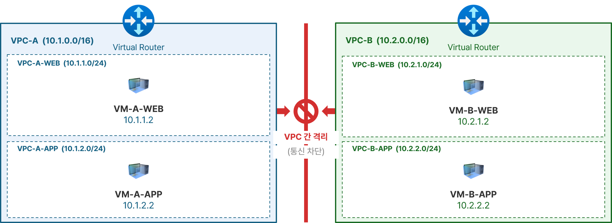{width="6.479166666666667in" height="2.358840769903762in"}

> 그림 ‑ VPC 구성도 예시

VPC간의 서브넷들끼리 통신하기 위해서는 VPC Gateway에 Public IP를 할당해서 외부 접속을 허용하거나 사이트 간 사설네트워크(VPN)을 통해 연결시켜야 한다. 아래의 그림은 Public IP를 할당해서 외부 접속을 허용한다.

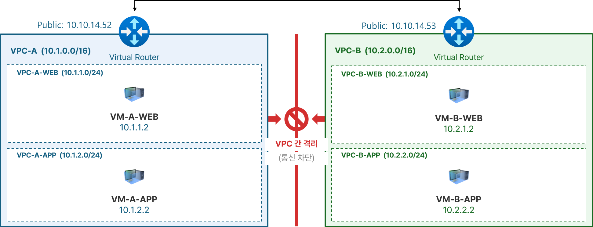{width="6.593748906386701in" height="2.529636920384952in"}

> 그림 ‑ 사이트간 사설 네트워크

예시로 나온 VPC-A, VPC-B와 같은 VPC를 만들기 위해 다음과 같은 과정을 거치게 된다.

아래 VPC 생성 화면을 통해 VPC를 추가한다.

입력해야하는 데이터는

- 이름

- Zone

- 도메인

- 계정

- CIDR

[VPC 예시](#_Ref233218762)에 해당하는 CIDR을 입력해보자. 해당하는 CIDR을 입력해보자. VPC-A의 경우, 입력 값은 10.1.0.0/16 이고 VPC-B의 경우, 입력 값은 10.2.0.0/16이다.예시에서 VPC-A는 10.1.0.0/16, VPC-B는 10.2.0.0/16을 사용하므로 두 대역이 겹치지 않는다. 각 VPC는 이 범위 안에서 서브넷을 나누어 사용한다.

**\* CIDR 선정 시 주의 사항**

1\) VPN으로 연결할 상대 VPC의 CIDR과 겹치지 않아야 한다. 대역이 겹치면 경로를 구분할 수 없어 사이트 간 VPN으로 연결할 수 없다.

2\) 사내망 등 실제로 사용 중인 대역과 겹치지 않아야 한다. 겹치는 경우 해당 대역으로의 통신이 VPC 내부로 잘못 전달된다.

3\) VPC의 CIDR은 생성한 다음에는 변경할 수 없다. 서브넷을 몇 개까지 나눌지 고려하여 충분한 크기로 지정한다.

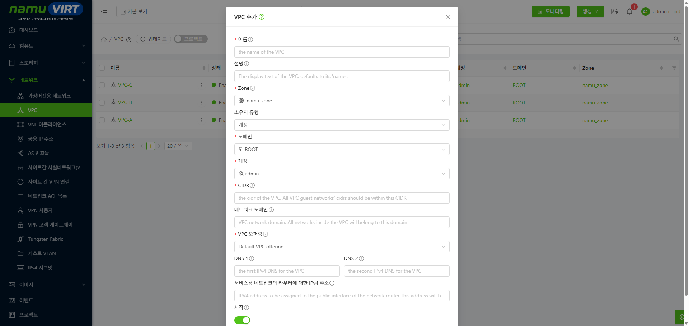{width="6.5784722222222225in" height="3.1194444444444445in"}

> 그림 ‑ VPC 생성 화면

VPC를 생성했다면 서브넷을 생성한다.

서브넷 생성 화면 에서 다음 정보들을 입력해서 생성한다.

- 이름

- 게이트웨이

  - CIDR을 입력한다.

- 넷마스크

- ACL

각 VPC 별로 서브넷을 2개씩 생성하는 것이 목표다.

서브넷은 VPC의 CIDR 안에 포함되는 CIDR을 가진다. 또한 ACL을 등록해서 해당 서브넷에 대해 세밀한 접근 제어가 가능하다. 이번에는 VPC-A-WEB과 VPC-A-APP, VPC-B-WEB을 다음과 같이 만든다.

- VPC-A-WEB: 10.1.1.0/24

- VPC-A-APP: 10.1.2.0/24

- VPC-B-WEB: 10.2.1.0/24

ACL을 입력할 때는 VPC-A-WEB과 VPC-A-APP, VPC-B-WEB의 경우에는 default_allow를 사용해서 모든 접속을 허용하게 만든다.

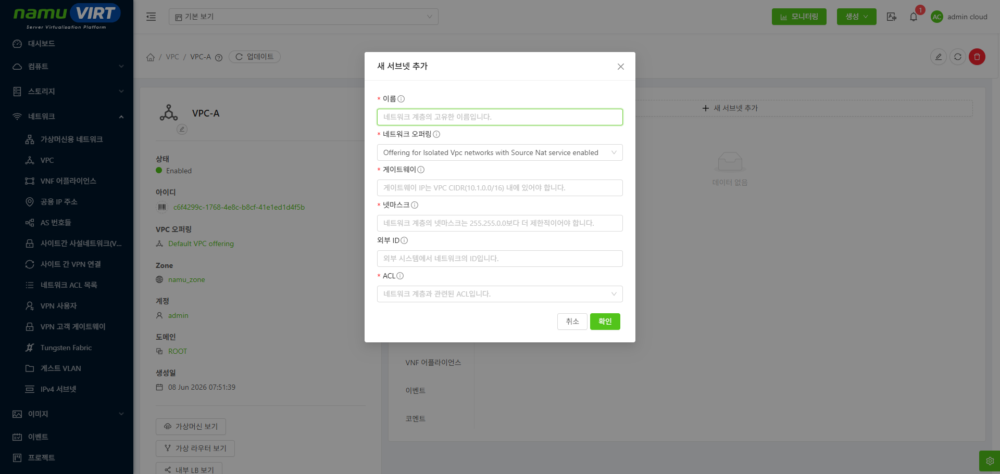{width="6.572916666666667in" height="3.1145833333333335in"}

> 그림 ‑ 서브넷 생성 화면

생성된 서브넷을 가상 네트워크 페이지에서 확인하면 아래 Isolated 로 인식되는 서브넷에서 보이듯 Isolated Network로 인식되는 것을 알 수 있다.

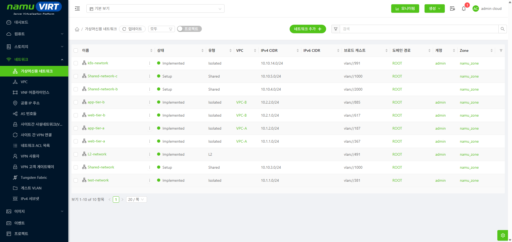{width="6.5784722222222225in" height="3.1215277777777777in"}

> 그림 ‑ Isolated 로 인식되는 서브넷

이후 VPC-A-WEB과 VPC-A-APP, VPC-B-WEB에 각각 VM을 하나씩 생성한다. 아래 VPC-A-WEB에서 VPC-A-APP 과 VPC-B-WEB으로 Ping 결과에서 알 수 있듯, VPC-A-WEB과 VPC-A-APP은 같은 VPC에 있어서 ping으로 통신할 수 있다. 그러나 VPC-B-WEB과는 VPC가 달라 ping이 loss 된다.

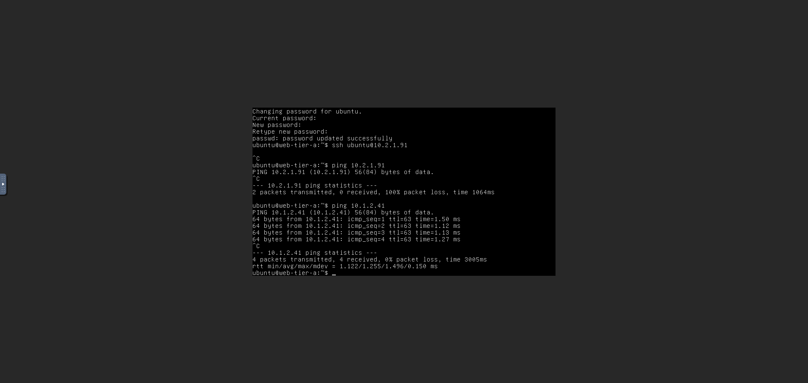{width="6.520833333333333in" height="3.7375503062117237in"}

> 그림 ‑ VPC-A-WEB에서 VPC-A-APP 과 VPC-B-WEB으로 Ping 결과

이번에는 같은 VPC라고 해도 ACL에 의해서 접근이 제어되도록 작업해보자. 서브넷에 ACL 목록을 지정하면 해당 목록의 규칙에 의해서 접근이 제어된다. VPC-B ACL 예시에서 VM-B-APP의 경우, vpc-b-deny라는 ACL이 적용 되어있다. 이 ACL은 다른 접속은 허용하지만 22번 포트는 deny하는 상태다.

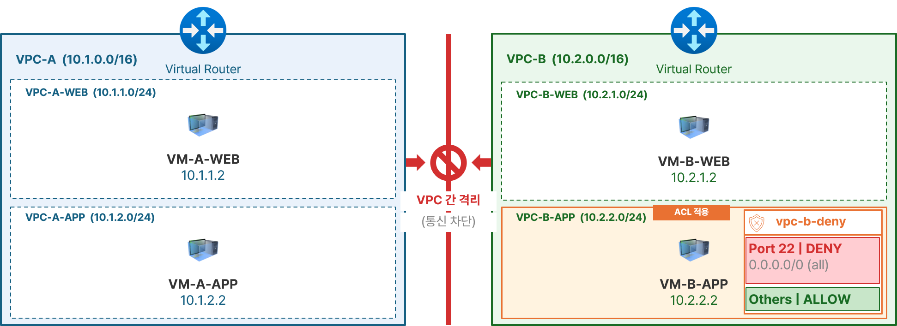{width="6.593748906386701in" height="2.4005555555555556in"}

> 그림 ‑ VPC-B ACL 예시

ACL은 default로 default_allow와 default_deny가 존재한다. 예시로 보여준 vpc-b-deny는 사용자가 직접 만들어서 적용한 것이다. 아래 ACL 목록 생성 화면과 같이 운영자가 ACL을 추가로 생성할 수 있다.

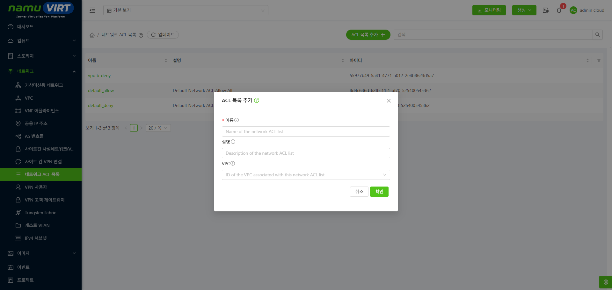{width="6.5784722222222225in" height="3.1194444444444445in"}

> 그림 ‑ ACL 목록 생성 화면

생성된 ACL 목록에 규칙을 추가해야 한다. ACL 규칙 생성 화면에서 아래 정보를 입력한다.\
\* 전송원 CIDR은 트래픽 유형에 따라 의미가 달라진다. 0.0.0.0/0은 모든 주소를 의미한다. 특정 서브넷만 제어하려면 해당 서브넷의 CIDR(예: 10.2.1.0/24)을 입력한다.

  -----------------------------------------------------------------------------
  **CIDR 트래픽 유형**   **설명**
  ---------------------- ------------------------------------------------------
  Ingress                서브넷으로 들어오는 트래픽의 출발지 주소 범위

  Egress                 서브넷에서 나가는 트래픽의 목적지 주소 범위
  -----------------------------------------------------------------------------

- #규칙: 자동으로 지정(규칙번호는 오름차순으로 적용)

- **전송원 CIDR:** 해당 ACL의 영향을 받을 상대방을 지정하는 CIDR

- **동작:** Allow/Deny

- **프로토콜**

- **시작 포트**

- **종료 포트**

- **트래픽 유형**

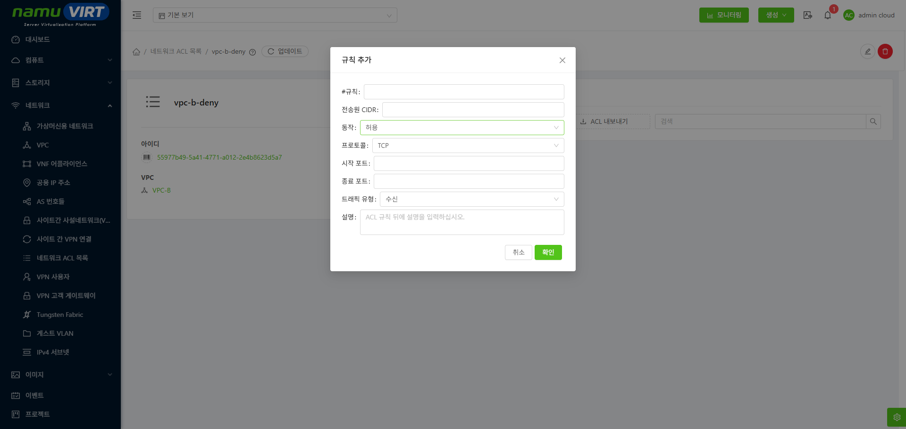{width="6.5784722222222225in" height="3.120138888888889in"}

> 그림 ‑ ACL 규칙 생성 화면

port 22번 금지 규칙 생성(ACL 규칙)

- **#규칙:** 자동으로 입력

- **전송원 CIDR:** 0.0.0.0/0

- **동작:** 거절

- **프로토콜:** tcp

- **시작 포트:** 22

- **종료 포트:** 22

- **트래픽 유형:** Ingress

모든 통신 허용 규칙 생성

- **#규칙:** 자동으로 입력

- **전송원 CIDR:** 0.0.0.0/0

- **동작:** 허용

- **프로토콜:** All

- **시작 포트:** 0

- **종료 포트:** 0

- **트래픽 유형:** Ingress

위의 정보로 생성 요청하면 ACL 목록 규칙 생성 결과와 같이 등록된다.

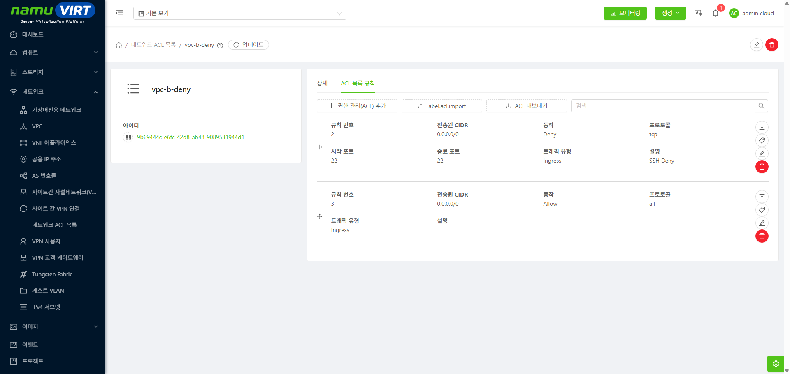{width="6.5784722222222225in" height="3.1215277777777777in"}

> 그림 ‑ ACL 목록 규칙 생성 결과

이제 vpc-b-deny가 적용되는 VPC-B-APP 서브넷을 생성하자. VPC-B-APP 서브넷은 10.2.2.0/24를 가진다.

이 구조에서는 VPC-B-WEB이 VPC-B-APP을 향해 거의 모든 통신이 허용되지만 22번 포트만은 거절된다.

아래의 사진 VPC-B-APP에 ACL vpc-b-deny 적용 결과에서 해당 상황을 확인할 수 있다.

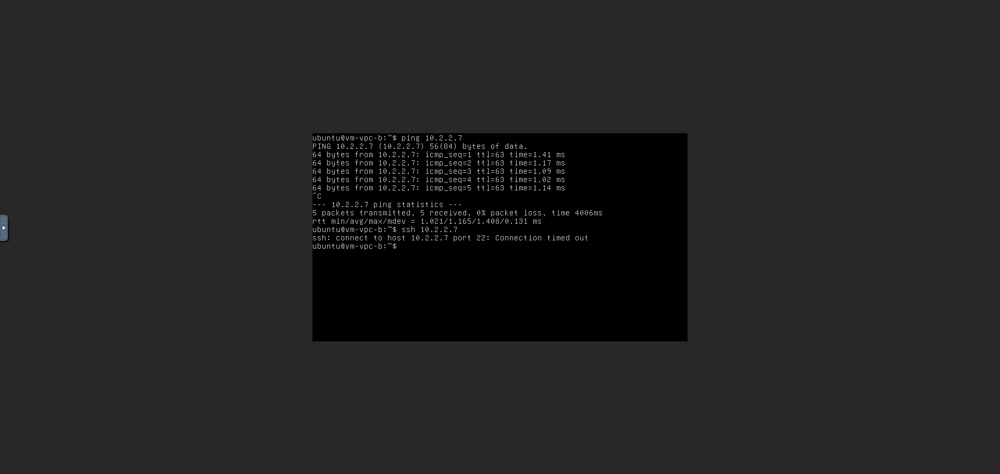{width="6.486111111111111in" height="3.5443219597550306in"}

> 그림 ‑ VPC-B-APP에 ACL vpc-b-deny 적용 결과

또한, VPC-B-WEB은 ACL이 default_allow기 때문에 VPC-B-APP이 VPC-B-WEB을 향해 22번 포트를 포함한 모든 통신이 허용된다. 아래 VPC-B-WEB 에서 VPC-B-APP으로 ping 및 22번 포트 통신 결과에서 이를 확인 가능하다.

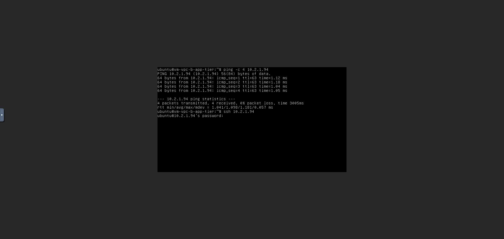{width="6.5625in" height="3.7908727034120733in"}

> 그림 ‑ VPC-B-WEB 에서 VPC-B-APP으로 ping 및 22번 포트 통신 결과
