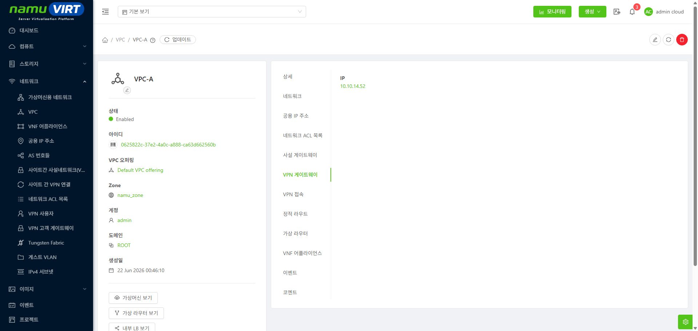
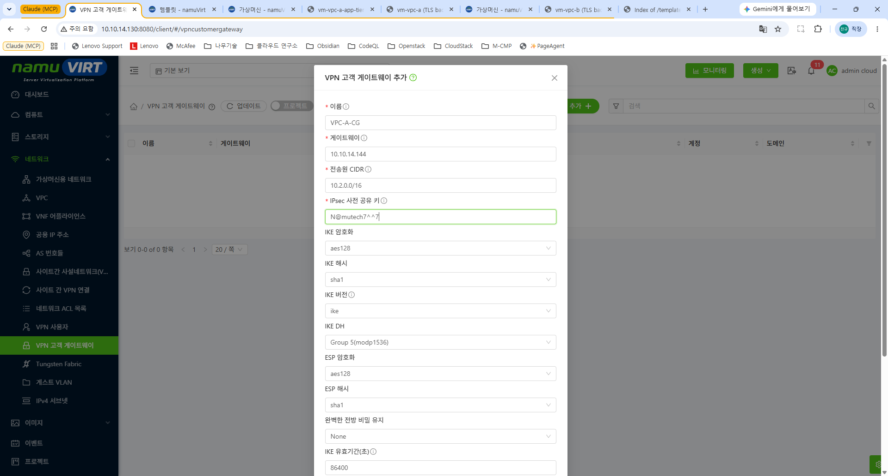
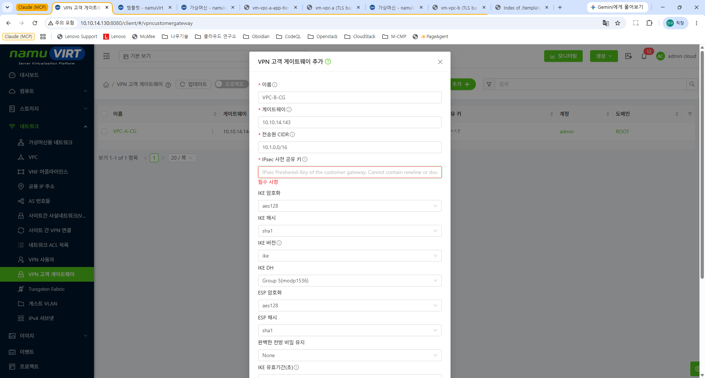
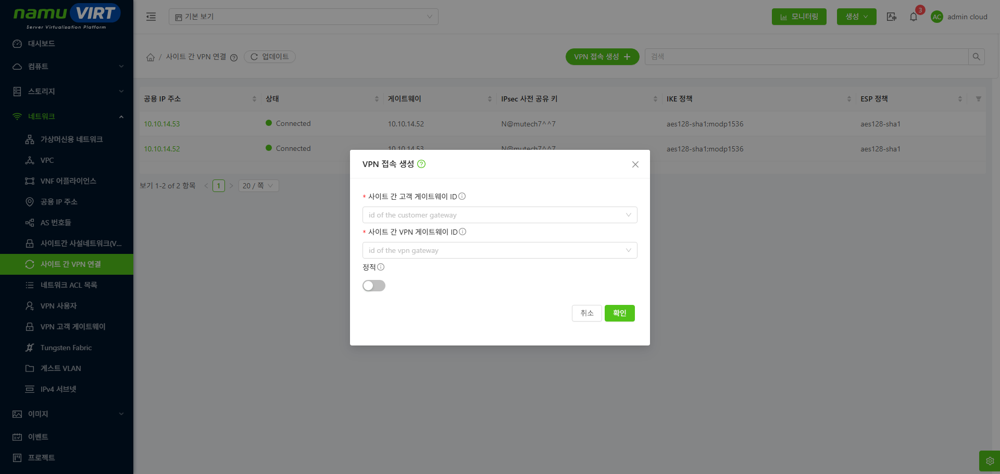
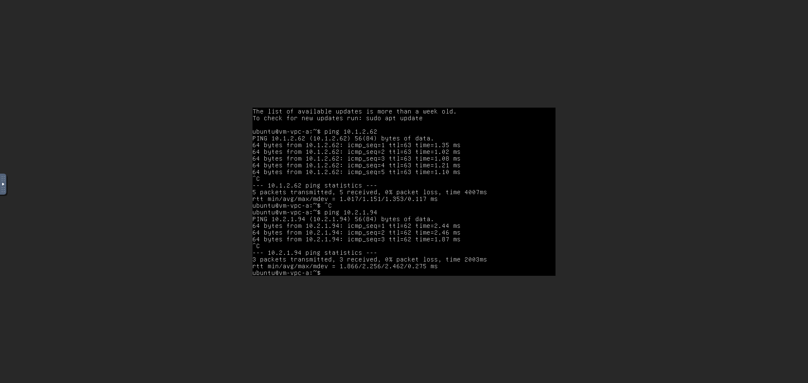
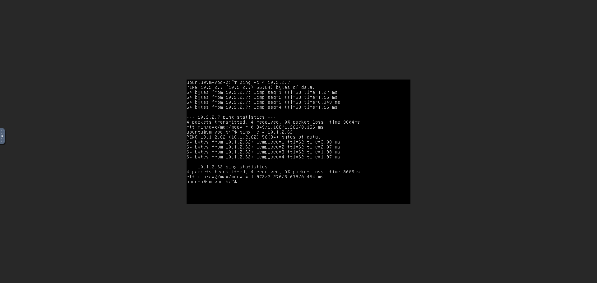
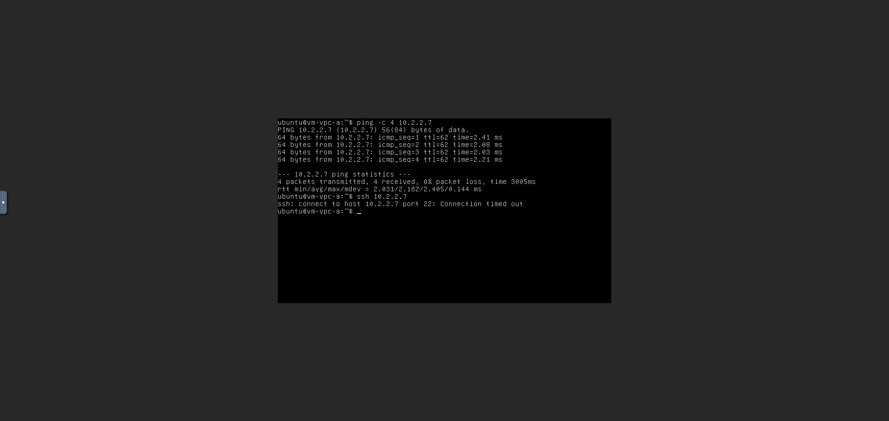

사이트 간 사설 네트워크는 두 VPC에 Gateway를 제공하고 이를 통해서 접속하는 방식이다.

이렇게 VPC간에 Gateway를 제공하기 위해, 먼저 VPC들은 각자의 Gateway를 생성해야 한다.

## 사전준비

{width="6.5784722222222225in" height="3.1215277777777777in"}

> 그림 ‑ VPC-A Gateway 생성 결과

{width="6.5784722222222225in" height="3.1215277777777777in"}

> 그림 ‑ VPC-B Gateway 생성 결과

게이트웨이가 생기면서 공용 IP를 할당 받게 된다. 이제 양쪽 VPC는 상대방의 공용 IP를 고객 게이트웨이로 등록해야 한다. vpc-a-cg 고객 게이트웨이 생성 화면에서 다음 정보를 입력한다.

- **이름:** 게이트웨이 이름을 작성한다.

- **게이트웨이:** VPC-B의 게이트웨이 Public IP 주소

- **전송원 CIDR :** VPC-B의 CIDR

- **IPsec 사전 공유키:** Gateway-고객 Gateway가 공유할 비밀 키

{width="6.5784722222222225in" height="3.129861111111111in"}

> 그림 ‑ vpc-a-cg 고객 게이트웨이 생성 화면

에는 다음과 같이 입력한다.

- **이름:** 고객 게이트웨이 이름을 작성한다.

- **게이트웨이:** VPC-A의 게이트웨이 Public IP 주소

- **전송원 CIDR:** VPC-A의 CIDR

- **IPsec 사전 공유키:** Gateway-고객 Gateway가 공유할 비밀 키

{width="6.5784722222222225in" height="3.129861111111111in"}

> 그림 ‑ vpc-b-cg 고객 게이트웨이 생성 화면

각각 상대방의 게이트웨이 주소와, 상대방의 CIDR을 입력해야 한다.

- **vpn-cgw-a:** 10.1.0.0/16

- **vpn-cgw-b:** 10.2.0.0/16

## VPN 연결 생성

VPN 연결을 이용해서 앞서 설정한 IPsec 사전 공유키를 통한 실제 IPsec 터널을 생성한다. 아래 VPN 연결 생성 화면에서 게이트웨이와 그 게이트웨이 정보가 입력된 고객 게이트웨이를 선택하고 생성한다.

{width="6.5784722222222225in" height="3.1215277777777777in"}

> 그림 ‑ VPN 연결 생성 화면

예시와 같은 사이트간 고객 게이트웨이와 사이트간 VPN 게이트웨이를 각각 다음과 같이 지정하면 된다.

- **vpn-a-cg:** 10.10.14.53

- **vpn-b-cg:** 10.10.14.52

이제 각 연결의 상태가 Connected가 되었다면 이제 각 VPC는 서로 통신 가능한 상태가 된다.

이전에 VPC-A-WEB에서 VPC-A-APP 과 VPC-B-WEB으로 Ping 결과와 달리 아래 VPC-A-WEB에서 VPC-A-APP/VPC-B-WEB으로 ping한 결과에서 순서대로 VPC-A-APP ping과 VPC-B-WEB ping이 전부 성공한 것을 알 수 있다. 또한 그 반대인 VPC-B-WEB에서 VPC-B-APP/VPC-A-APP으로 ping한 결과도 마찬가지로 성공하는 것을 알 수 있다.

{width="6.523827646544182in" height="3.6805555555555554in"}

> 그림 ‑ VPC-A-WEB에서 VPC-A-APP/VPC-B-WEB으로 ping한 결과

{width="6.479166666666667in" height="3.692612642169729in"}

> 그림 ‑ VPC-B-WEB에서 VPC-B-APP/VPC-A-APP으로 ping한 결과

참고로 ACL은 여전히 동작한다. 아래의 VPC-A-WEB에서 VPC-B-APP에 ping 및 22번 포트 통신 결과의 경우에서 vm-vpc-a는 VPN의 도움으로 vm-vpc-b-app-tier에 ping을 날리는 것은 가능하지만 22번 포트는 여전히 ACL로 인해 불가능한 모습이다.

{width="6.5784722222222225in" height="3.1215277777777777in"}

> 그림 ‑ VPC-A-WEB에서 VPC-B-APP에 ping 및 22번 포트 통신 결과
